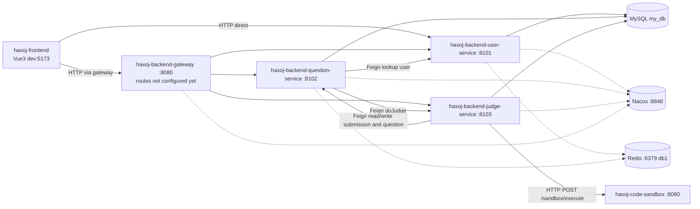

# haxoj-backend-microservice

Backend of an online judge (OJ) system — microservice edition.

> **Current status (important)**
> This repository is in the middle of a "monolith → microservices" split. This document describes **only what actually exists in the code**:
> - Done: module split, centralized dependency versions, Nacos service registration, Sentinel integration, remote code-sandbox integration, **cross-service Feign calls** (the 3 contracts in `service-client` are annotated with `@FeignClient`, consumers enable `@EnableFeignClients`, and providers expose their inner endpoints)
> - In progress: **gateway routing rules**, and the SQL scripts for the question tables
> - Not enabled: Nacos config center, Redis (configured only, unused in code), message queue

## 1. Overview

**Positioning**: a Maven multi-module online judge backend built on Spring Cloud Alibaba. The four responsibilities — user / question / judging / gateway — are split into independently deployable services, with a dedicated code-sandbox service safely executing user code.

**Core modules**

| Module | Responsibility |
| --- | --- |
| User service | Sign-up, login, logout, permissions and user management, file upload (Tencent Cloud COS) |
| Question service | Question CRUD, code submission, submission query, batch question import (EasyExcel) |
| Judge service | Calls the sandbox to execute code, compares results by strategy, writes back status and judge info |
| Gateway | Unified entry point, request routing (dependencies in place, routes not yet configured) |
| Code sandbox (separate service) | Compiles and runs user code in an isolated environment (see `haxoj-code-sandbox`) |

**Tech stack**

| Category | Choice | Version / Notes |
| --- | --- | --- |
| Language / compile level | Java | `java.version = 1.8` |
| Build | Maven | multi-module aggregator parent |
| Base framework | Spring Boot | 2.6.13 |
| Microservice framework | Spring Cloud | 2021.0.5 |
| Microservice suite | Spring Cloud Alibaba | 2021.0.5.0 |
| Gateway | Spring Cloud Gateway (WebFlux) | `spring-cloud-starter-gateway` |
| Registry | Nacos Discovery | `server-addr: 127.0.0.1:8848`, `namespace: public` |
| Config center | **Not enabled** | no `bootstrap.yml`, and Nacos Config is not imported |
| Traffic protection | Sentinel | `dashboard: localhost:8080`, `eager: true` |
| Service calls | OpenFeign + Spring Cloud LoadBalancer | the 3 `@FeignClient` contracts in `service-client` are ready to use; question / judge services enable `@EnableFeignClients` and pull in `loadbalancer` |
| Persistence | MyBatis-Plus | 3.5.2 (`mybatis-plus-boot-starter` / `mybatis-plus-annotation`) |
| Database | MySQL | driver `mysql-connector-j`, `jdbc:mysql://localhost:3306/my_db` |
| Cache | Redis | configured (localhost:6379 / db 1), **unused in code** |
| Message queue | **Not used** | no RabbitMQ / RocketMQ / Kafka dependency |
| API docs | Knife4j | `knife4j.enable: true` in user / question services |
| Utilities | Hutool 5.8.8, Gson 2.9.1, commons-lang3, commons-collections4 4.4, Lombok 1.18.30 | — |
| Object storage | Tencent Cloud COS | `cos_api` 5.6.89 (user service) |
| Excel import | EasyExcel | 3.1.1 (question service) |

> Lombok is pinned to `1.18.30` because Maven here runs on JDK 21, where the default 1.18.24 annotation processor from the Spring Boot BOM throws `NoSuchFieldError`; the version is therefore overridden explicitly in the parent `pom.xml`.

## 2. Architecture

**Overall diagram**



**Service responsibilities**

| Service | Port | context-path | Notes |
| --- | --- | --- | --- |
| `haxoj-backend-gateway` | 8080 | — | WebFlux gateway; **its `application.properties` in this repo only sets the port**, routing rules are not in place |
| `haxoj-backend-user-service` | 8101 | `/api` | Users, permissions, file upload; exposes `/user/**`, `/file/upload` |
| `haxoj-backend-question-service` | 8102 | `/api` | Questions and submissions; exposes `/question/**`, `/question_submit/**` |
| `haxoj-backend-judge-service` | 8103 | `/api` | Judging logic; **no public business controller** — it only exposes the inner endpoint `JudgeInnerController` (`/api/judge/inner/do`) for question-service to call |
| `haxoj-code-sandbox` | 8080 | — | Separately deployed sandbox service exposing `POST /sandbox/execute` |

**Shared modules** (not runnable services, not packaged as fat jars, only referenced as dependencies)

| Module | Responsibility |
| --- | --- |
| `haxoj-backend-common` | `BaseResponse` / `ErrorCode` / global exception handling / `CorsConfig` / `MyBatisPlusConfig` (with `@MapperScan`) / `LogInterceptor` |
| `haxoj-backend-model` | entities (`User` / `Question` / `QuestionSubmit`), DTOs, VOs, enums |
| `haxoj-backend-service-client` | cross-service contracts (a jar library — no implementation, no main class): the three `@FeignClient` interfaces `UserFeignClient` / `QuestionFeignClient` / `JudgeFeignClient` |

**Service interactions and data flow**

1. **Frontend → backend**: the frontend uses `VITE_API_BASE_URL` (currently `http://localhost:8101`); generated API paths already carry the `/api` prefix.
2. **Submission flow**: `question-service` writes the submission into the `question_submit` table with status `WAITING`, then **calls `judge-service` remotely** via `JudgeFeignClient.doJudge()` (wrapped in `CompletableFuture.runAsync`, so it runs asynchronously and never blocks the user request), and returns the `questionSubmitId` immediately. With a remote proxy the local circular dependency disappears, so the former `@Lazy` was removed.
3. **Judging flow**: `JudgeServiceImpl.doJudge()` reads the submission and the question through `QuestionFeignClient` → picks a sandbox via `CodeSandboxFactory` based on `codesandbox.type` → in `remote` mode `RemoteCodeSandbox` **calls the standalone sandbox service over HTTP** with header `auth = MD5("secretKey")` → compares output using a language strategy (`JavaLanguageJudgeStrategy` / `DefaultJudgeStrategy`) → writes the status and `judgeInfo` back through `QuestionFeignClient`.
4. **Sandbox address**: `SANDBOX_EXECUTE_URL` in `RemoteCodeSandbox` is currently hard-coded to `http://192.168.221.45:8080/sandbox/execute`.

**Cross-service call matrix (Feign)**

| Consumer | Contract | Purpose |
| --- | --- | --- |
| `question-service` | `UserFeignClient` | `getById` / `listByIds` to fill in the user info of a submission |
| `question-service` | `JudgeFeignClient` | `doJudge` to trigger judging asynchronously |
| `judge-service` | `QuestionFeignClient` | read submission / question, write back status, increment the accepted count |
| `user-service` | — | provider only; OpenFeign is not even on its classpath |

> On the provider side, these calls are served by each service's `XxxInnerController` (`/api/user/inner`, `/api/question/inner`, `/api/judge/inner`).
> Note: providers do **not** `implements` the contract interfaces — the two sides agree by "path + parameters + return type" instead.
> See `OJ 项目文档/notes/2026-10-17_Feign声明式服务调用与service-client.md`.

> ⚠️ Both the sandbox service and the gateway use port 8080, and the Sentinel Dashboard is also configured as `localhost:8080`. Deployments must separate these across hosts or ports (see section 7).

## 3. Requirements

| Component | Version | Notes |
| --- | --- | --- |
| JDK | 1.8 | compile level `source/target = 1.8`; running Maven on a newer JDK requires the Lombok 1.18.30 pin |
| Maven | 3.6+ | aggregator build from the parent project |
| MySQL | 8.x | `mysql-connector-j`, database `my_db` |
| Redis | 6+ | `localhost:6379`, `database: 1`; **configured only, unused in code** |
| Nacos | 2.x (standalone) | `127.0.0.1:8848`, credentials `nacos / nacos`, namespace `public` |
| Sentinel Dashboard | optional | configured as `localhost:8080` (conflicts with the gateway port, adjust as needed) |
| Docker | optional | only needed for the sandbox's Docker mode |
| Node.js | needed to build the frontend | see `haxoj-frontend` |

## 4. Quick Start

**Step 1: initialize the database**

```bash
mysql -uroot -p my_db < ../haxoj-backend/sql/create_table.sql
```

> Note: `haxoj-backend/sql/create_table.sql` **only contains four tables — `user`, `post`, `post_thumb`, `post_favour`**. The SQL for the question tables (`question`, `question_submit`) is **not in this repository** and must be prepared yourself.

**Step 2: start Nacos**

```bash
# standalone mode (example)
sh startup.sh -m standalone
# console: http://127.0.0.1:8848/nacos , user/password: nacos/nacos
```

**Step 3: adjust configuration**

Service config lives in `*/src/main/resources/application.yml` (`spring.profiles.active=dev`; **there is no `application-dev.yml` in the repo — everything is written directly in `application.yml`**):

- DB password: injected via the `MYSQL_PASSWORD` environment variable (`password: ${MYSQL_PASSWORD:}`); you may also put it in plain text locally
- Redis: verify `host/port/database` against your machine
- Tencent Cloud COS (user service only): replace the `xxx` placeholders in `accessKey / secretKey / region / bucket`, otherwise `/file/upload` will not work
- Sandbox address: point `RemoteCodeSandbox.SANDBOX_EXECUTE_URL` at your actual sandbox deployment
- Registry: make sure `spring.cloud.nacos.discovery.server-addr` is reachable

**Step 4: build**

```bash
# from the haxoj-backend-microservice directory
mvn clean install -DskipTests
```

**Step 5: start in order**

Recommended order: `user-service` → `question-service` → `judge-service` → `gateway`.

```bash
# option 1: run a single module
mvn -pl haxoj-backend-user-service spring-boot:run
# option 2: run packaged jars (one process per service)
java -jar haxoj-backend-user-service/target/haxoj-backend-user-service-0.0.1-SNAPSHOT.jar
```

**Step 6: verify**

1. Open the Nacos console → service list; all services should be registered.
2. Hit the "current user" endpoint (a business error code when not logged in means the service is up):
   `GET http://localhost:8101/api/user/get/login`
3. API docs (Knife4j enabled in user / question services): `http://localhost:8101/api/doc.html`, `http://localhost:8102/api/doc.html`
4. The judging path additionally requires `haxoj-code-sandbox` to be running and reachable.

## 5. Project Structure

```
haxoj-backend-microservice/
├── pom.xml                          # parent: aggregates modules, pins versions, configures plugins
├── haxoj-backend-common/            # shared: response wrapper, error codes, global exception handler, utils
├── haxoj-backend-model/             # domain model: entities, DTOs, VOs, enums
├── haxoj-backend-service-client/    # service contracts: three @FeignClient interfaces (no impl, no main class)
├── haxoj-backend-gateway/           # gateway: unified entry, routing (WebFlux)
├── haxoj-backend-user-service/      # user service
├── haxoj-backend-question-service/  # question service
└── haxoj-backend-judge-service/     # judge service
    ├── judge/                       #   JudgeService / JudgeManager / judging strategies
    └── judge/codesandbox/           #   sandbox abstraction, factory, example/remote/third-party impls
```

**Conventions**

- **All dependency versions are managed in the parent `pom.xml`'s `dependencyManagement`**; child modules only declare *what* they need, never versions. Non-Spring dependencies must be declared **before** the BOM `import` (Maven's "first declaration wins").
- **Shared code goes in `common`, entities/DTOs/VOs in `model`, cross-service interfaces in `service-client`**; business implementations stay inside their own service.
- **Only runnable services pull in `spring-boot-maven-plugin`**; library modules are not packaged as executable jars.
- **The gateway is WebFlux-based — never add `spring-boot-starter-web`**, or startup fails with a conflict.
- API paths always include the service `context-path` (every service uses `/api`).

## 6. Deployment

**Development (dev)**

- `spring.profiles.active=dev`; config lives in `application.yml`, connecting to local MySQL / Redis / Nacos.
- Run via `mvn ... spring-boot:run` or directly from the IDE.

**Test / production**

- Build: `mvn clean package -DskipTests`; each runnable service produces a fat jar.
- Run: `java -jar xxx-service.jar --spring.config.additional-location=/path/to/prod.yml` to override `application.yml` with an external file — **never bake plaintext passwords into the jar**.
- Key external settings: `MYSQL_PASSWORD`, Nacos `server-addr` / `namespace`, Sentinel `dashboard`, sandbox address.
- Port planning: the gateway, business services, sandbox service and Sentinel Dashboard **must use distinct ports** (the current defaults conflict on 8080).

**Notes**

- The repo contains **no** `Dockerfile`, `docker-compose`, Kubernetes manifests or CI config; containerization and pipelines must be added.
- The sandbox address in `RemoteCodeSandbox` is a **hard-coded constant**; it must be changed in code when moving environments (better to make it configurable).
- `codesandbox.type` selects the judging sandbox: `example` (sample, default fallback) / `remote` (remote sandbox, the current value in `judge-service`) / `third party`. Unrecognized values fall back to `example`.
- Judging is triggered asynchronously by `CompletableFuture.runAsync`; its result is never observed and its exception is not captured, so a failed judging silently leaves the submission at `WAITING`. It also uses the common ForkJoinPool rather than a dedicated executor.
- No explicit Feign timeout is configured for cross-service calls (defaults apply), and Sentinel circuit-breaking / fallback is not wired up (dependency present, but no rules).

## 7. FAQ

| Symptom | Cause | Fix |
| --- | --- | --- |
| Startup fails to connect to Nacos | Nacos not running or wrong address | Start standalone Nacos; check `spring.cloud.nacos.discovery.server-addr` |
| Startup error `No Feign Client for loadBalancing defined` | since Spring Cloud 2021.x, `openfeign` no longer bundles a load balancer | add `spring-cloud-starter-loadbalancer` to the consumer's pom (already done in question / judge services) |
| Injecting `XxxFeignClient` throws `NoSuchBeanDefinitionException` | the consumer's main class is missing `@EnableFeignClients`, or the contracts are outside its scanned package | add `@EnableFeignClients` to the main class; contracts under `com.hax.haxojbackend` sub-packages are scanned by default |
| Gateway won't start / MVC conflict | `spring-boot-starter-web` was added by mistake | keep only Gateway (WebFlux) dependencies |
| Sentinel console unreachable | `dashboard` port 8080 equals the gateway port | move the Sentinel Dashboard to another port and update config |
| Database connection fails | password not injected | set the `MYSQL_PASSWORD` env var, or put it in plain text in the yml |
| Frontend session never established | cross-origin cookies not sent | frontend needs `withCredentials` (see `haxoj-frontend`) and the backend `CorsConfig` must allow the origin |
| Submission stays `WAITING` forever | judging is triggered asynchronously (`CompletableFuture.runAsync`) and its exception is currently not captured, so failures are invisible to the client | verify `judge-service` is registered in Nacos and its logs show no errors; the missing exception handling is a known limitation (see section 6 notes) |
| Compile error `NoSuchFieldError: JCTree$JCImport.qualid` | Lombok too old | the parent pins Lombok 1.18.30 — do not downgrade |
| Snowflake ID precision loss | 19-digit Long converted to JS Number | pass IDs as strings between frontend and backend |

## 8. Contributing

**Branches & commits**

- Branch model: `main` (stable) → `feature/*`, `fix/*`.
- Commit messages follow Conventional Commits: `feat:` / `fix:` / `refactor:` / `docs:` / `chore:`, one concern per commit.

**PR flow**

1. Branch off `main`; finish the work and make sure the local build passes (`mvn clean install`).
2. Open a PR describing what changed, why, and how you verified it (with endpoints / logs).
3. Merge after at least one maintainer review; do not push directly to `main`.

**Versioning**

- The version is defined once in the parent `pom.xml` `<version>` (currently `0.0.1-SNAPSHOT`); child modules inherit it via `${project.version}` — **never hard-code a version in a child module**.
- To add a third-party dependency: pin the version in the parent `properties` → declare it in `dependencyManagement` → only then reference it version-less in a child module.
