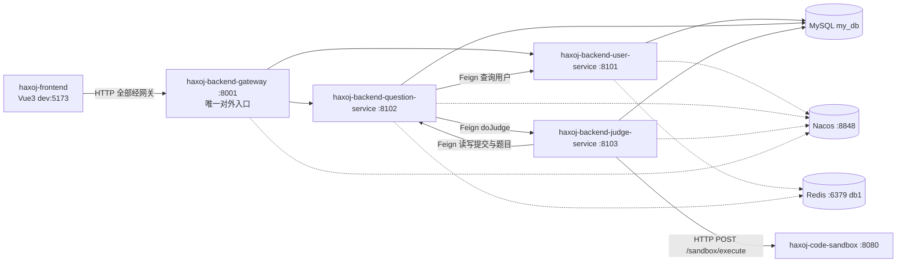

# haxoj-backend-microservice

在线判题系统（OJ）后端 —— 微服务版。

> **当前进度说明（重要）**
> 本仓库正处于「单体 → 微服务」的拆分过程中，文档只描述**代码里真实存在的状态**：
> - 已完成：模块拆分、依赖版本收敛、Nacos 服务注册、Sentinel 接入、远程代码沙箱对接、**跨服务 Feign 调用**（`service-client` 中 3 个契约已标注 `@FeignClient`，消费方已加 `@EnableFeignClients`，提供方已补齐内部接口）
> - 进行中：**网关路由规则**、题库相关建表脚本
> - 未启用：Nacos 配置中心、Redis（仅配置在案，代码未使用）、消息队列

## 1. 项目概述

**项目定位**：一个基于 Maven 多模块 + Spring Cloud Alibaba 的在线判题系统后端，把「用户 / 题目 / 判题 / 网关」四类职责拆成独立可部署的服务，并由独立的代码沙箱服务负责安全执行用户代码。

**核心功能模块**

| 模块 | 职责 |
| --- | --- |
| 用户服务 | 注册、登录、注销、权限与用户管理、文件上传（腾讯云 COS） |
| 题目服务 | 题目增删改查、题目提交、提交记录查询、题目批量导入（EasyExcel） |
| 判题服务 | 调用代码沙箱执行判题、按策略比对结果、回写判题状态与判题信息 |
| 网关 | 统一入口、路由转发（依赖已就位，路由规则待配置） |
| 代码沙箱（独立服务） | 在隔离环境中编译并运行用户代码（见 `haxoj-code-sandbox`） |

**技术栈选型**

| 分类 | 选型 | 版本 / 说明 |
| --- | --- | --- |
| 语言 / 编译级别 | Java | `java.version = 1.8` |
| 构建 | Maven | 多模块聚合父工程 |
| 基础框架 | Spring Boot | 2.6.13 |
| 微服务框架 | Spring Cloud | 2021.0.5 |
| 微服务套件 | Spring Cloud Alibaba | 2021.0.5.0 |
| 网关 | Spring Cloud Gateway（WebFlux） | `spring-cloud-starter-gateway` |
| 注册中心 | Nacos Discovery | `server-addr: 127.0.0.1:8848`，`namespace: public` |
| 配置中心 | **未启用** | 仓库内没有 `bootstrap.yml`，也没有引入 Nacos Config |
| 流量防护 | Sentinel | `dashboard: localhost:8080`，`eager: true` |
| 服务调用 | OpenFeign + Spring Cloud LoadBalancer | `service-client` 中 3 个 `@FeignClient` 契约已可用；question / judge 服务已加 `@EnableFeignClients` 与 `loadbalancer` |
| 持久层 | MyBatis-Plus | 3.5.2（`mybatis-plus-boot-starter` / `mybatis-plus-annotation`） |
| 数据库 | MySQL | 驱动 `mysql-connector-j`，`jdbc:mysql://localhost:3306/my_db` |
| 缓存 | Redis | 配置在案（localhost:6379 / db 1），**代码中未使用** |
| 消息队列 | **未使用** | 无 RabbitMQ / RocketMQ / Kafka 依赖 |
| 接口文档 | Knife4j | user / question 服务 `knife4j.enable: true` |
| 工具库 | Hutool 5.8.8、Gson 2.9.1、commons-lang3、commons-collections4 4.4、Lombok 1.18.30 | — |
| 对象存储 | 腾讯云 COS | `cos_api` 5.6.89（用户服务） |
| 表格导入 | EasyExcel | 3.1.1（题目服务） |

> Lombok 之所以锁 `1.18.30`：本机 Maven 运行在 JDK 21 上，Spring Boot BOM 默认的 1.18.24 注解处理器会抛 `NoSuchFieldError`，故在父 `pom.xml` 中显式覆盖。

## 2. 架构说明

**整体架构图**



**各服务职责划分**

| 服务 | 端口 | context-path | 说明 |
| --- | --- | --- | --- |
| `haxoj-backend-gateway` | 8001 | — | WebFlux 网关，**唯一对外入口**；路由已落地（`/api/user/**`、`/api/file/**` → user；`/api/question/**`、`/api/question_submit/**` → question），并拦住 `/api/inner/**` |
| `haxoj-backend-user-service` | 8101 | `/api` | 用户、权限、文件上传；对外提供 `/user/**`、`/file/upload` |
| `haxoj-backend-question-service` | 8102 | `/api` | 题目与提交；对外提供 `/question/**`、`/question_submit/**` |
| `haxoj-backend-judge-service` | 8103 | `/api` | 判题逻辑；**无对外业务 Controller**，仅暴露内部接口 `JudgeInnerController`（`/api/inner/judge/do`）供 question-service 调用，网关也不为其开路由 |
| `haxoj-code-sandbox` | 8080 | — | 独立部署的沙箱服务，对外 `POST /sandbox/execute` |

**公共模块**（不是可执行服务，不打包成 fat jar，仅作为依赖被引用）

| 模块 | 职责 |
| --- | --- |
| `haxoj-backend-common` | `BaseResponse` / `ErrorCode` / 全局异常处理 / `CorsConfig` / `MyBatisPlusConfig`（含 `@MapperScan`）/ `LogInterceptor` |
| `haxoj-backend-model` | 实体（`User` / `Question` / `QuestionSubmit`）、DTO、VO、枚举 |
| `haxoj-backend-service-client` | 跨服务接口契约（jar 库，无实现、无启动类）：`UserFeignClient` / `QuestionFeignClient` / `JudgeFeignClient` 三个 `@FeignClient` 接口 |

**服务间调用关系与数据流**

1. **前端 → 后端**：前端通过 `VITE_API_BASE_URL` 访问后端（当前指向网关 `http://localhost:8001`），生成的接口路径自带 `/api` 前缀。
2. **题目提交链路**：`question-service` 收到提交后写入 `question_submit` 表，状态置为 `WAITING`，再通过 `JudgeFeignClient.doJudge()` **远程调用 `judge-service`**（包在 `CompletableFuture.runAsync` 中，异步执行、不阻塞用户请求），随后立即返回 `questionSubmitId`。改用远程代理后本地循环依赖消失，原先的 `@Lazy` 已移除。
3. **判题链路**：`JudgeServiceImpl.doJudge()` 通过 `QuestionFeignClient` 读取提交记录与题目 → 通过 `CodeSandboxFactory` 按 `codesandbox.type` 选沙箱 → `remote` 模式下由 `RemoteCodeSandbox` **以 HTTP 调用独立的沙箱服务**，请求头 `auth = MD5("secretKey")` → 按语言策略（`JavaLanguageJudgeStrategy` / `DefaultJudgeStrategy`）比对输出 → 再通过 `QuestionFeignClient` 回写提交状态与 `judgeInfo`。
4. **沙箱地址**：`RemoteCodeSandbox` 中的 `SANDBOX_EXECUTE_URL` 当前硬编码为 `http://192.168.221.45:8080/sandbox/execute`。

**服务间调用矩阵（Feign）**

| 消费方 | 使用的契约 | 用途 |
| --- | --- | --- |
| `question-service` | `UserFeignClient` | `getById` / `listByIds`，补全提交记录中的用户信息 |
| `question-service` | `JudgeFeignClient` | `doJudge`，异步触发判题 |
| `judge-service` | `QuestionFeignClient` | 读提交 / 题目、回写状态、题目通过数 +1 |
| `user-service` | — | 纯提供方，未引入 OpenFeign |

> 提供方一侧由各自的 `XxxInnerController`（`/api/inner/user`、`/api/inner/question`、`/api/inner/judge`）承接这些调用。
> 注意：提供方**不是** `implements` 契约接口，而是靠「路径 + 参数 + 返回类型」的约定对齐。
> 详见 `OJ 项目文档/notes/2026-10-17_Feign声明式服务调用与service-client.md`。

> ⚠️ 沙箱服务与 Sentinel Dashboard 都使用 8080 端口（网关已改用 8001 避开）。部署时需把它们错开到不同机器或不同端口（见第 7 节）。

## 3. 环境依赖

| 组件 | 版本要求 | 说明 |
| --- | --- | --- |
| JDK | 1.8 | 编译级别 `source/target = 1.8`；用高版本 JDK 跑 Maven 需注意 Lombok 已锁 1.18.30 |
| Maven | 3.6+ | 父工程聚合构建 |
| MySQL | 8.x | `mysql-connector-j`，库名 `my_db` |
| Redis | 6+ | 地址 `localhost:6379`，`database: 1`；**当前仅配置，代码未使用** |
| Nacos | 2.x（standalone） | `127.0.0.1:8848`，账号 `nacos / nacos`，命名空间 `public` |
| Sentinel Dashboard | 可选 | 配置为 `localhost:8080`（与沙箱服务端口冲突，需自行调整） |
| Docker | 可选 | 仅当代码沙箱使用 Docker 模式时需要 |
| Node.js | 前端构建需要 | 见 `haxoj-frontend` |

## 4. 快速启动

**第 1 步：初始化数据库**

```bash
mysql -uroot -p my_db < ../haxoj-backend/sql/create_table.sql
```

> 注意：仓库内 `haxoj-backend/sql/create_table.sql` **只包含 `user`、`post`、`post_thumb`、`post_favour` 四张表**；题库相关表（`question`、`question_submit`）的建表脚本**目前不在仓库内**，需自行准备并建好。

**第 2 步：启动 Nacos**

```bash
# standalone 模式（示例）
sh startup.sh -m standalone
# 打开控制台 http://127.0.0.1:8848/nacos ，账号/密码 nacos/nacos
```

**第 3 步：修改配置**

各服务配置位于 `*/src/main/resources/application.yml`（`spring.profiles.active=dev`；**仓库内没有 `application-dev.yml`，所有配置都直接写在 `application.yml` 中**）：

- 数据库密码：以环境变量 `MYSQL_PASSWORD` 注入（`password: ${MYSQL_PASSWORD:}`），本地也可直接填明文
- Redis：确认 `host/port/database` 与本机一致
- 腾讯云 COS（仅用户服务）：把 `accessKey / secretKey / region / bucket` 的 `xxx` 换成真实值，否则 `/file/upload` 不可用
- 沙箱地址：`RemoteCodeSandbox.SANDBOX_EXECUTE_URL` 需指向你实际部署沙箱服务的地址
- 注册中心：确认 `spring.cloud.nacos.discovery.server-addr` 可达

**第 4 步：构建**

```bash
# 在 haxoj-backend-microservice 目录下
mvn clean install -DskipTests
```

**第 5 步：按顺序启动**

推荐顺序：`user-service` → `question-service` → `judge-service` → `gateway`。

```bash
# 方式一：分模块直接跑
mvn -pl haxoj-backend-user-service spring-boot:run
# 方式二：打包后运行（每个服务一个进程）
java -jar haxoj-backend-user-service/target/haxoj-backend-user-service-0.0.1-SNAPSHOT.jar
```

**第 6 步：验证**

1. 打开 Nacos 控制台 → 服务列表，应能看到各服务已注册。
2. 访问用户登录态接口（未登录会返回业务错误码，说明服务已起来）：
   `GET http://localhost:8001/api/user/get/login`（经网关；直连 8101 同样可用）
3. 接口文档（user / question 服务已开启 Knife4j）：`http://localhost:8101/api/doc.html`、`http://localhost:8102/api/doc.html`
4. 判题链路需另起 `haxoj-code-sandbox` 服务并确保沙箱地址可达。

## 5. 项目结构

```
haxoj-backend-microservice/
├── pom.xml                          # 父工程：聚合模块、锁定版本、统一插件
├── haxoj-backend-common/            # 公共模块：返回对象、错误码、全局异常、通用工具
├── haxoj-backend-model/             # 领域模型：实体、DTO、VO、枚举
├── haxoj-backend-service-client/    # 服务契约：三个 @FeignClient 接口（无实现、无启动类）
├── haxoj-backend-gateway/           # 网关：统一入口、路由转发（WebFlux）
├── haxoj-backend-user-service/      # 用户服务
├── haxoj-backend-question-service/  # 题目服务
└── haxoj-backend-judge-service/     # 判题服务
    ├── judge/                       #   JudgeService / JudgeManager / 判题策略
    └── judge/codesandbox/           #   沙箱抽象、工厂、示例/远程/第三方实现
```

**开发规范**

- **依赖版本一律在父 `pom.xml` 的 `dependencyManagement` 中管控**，子模块只声明「要什么」不写版本；非 Spring 生态的依赖条目必须写在 BOM `import` **之前**（Maven「先声明者优先」）。
- **公共代码放 `common`，实体/DTO/VO 放 `model`，跨服务接口放 `service-client`**，业务实现留在各自服务内。
- **只有可执行服务才引入 `spring-boot-maven-plugin`**；公共库模块不打包成可执行 jar。
- **网关基于 WebFlux，严禁再引入 `spring-boot-starter-web`**，否则启动报冲突。
- 接口路径统一带服务 `context-path`（各服务均为 `/api`）。

## 6. 部署说明

**开发环境（dev）**

- `spring.profiles.active=dev`，配置直接写在 `application.yml`，本机连 `localhost` 的 MySQL / Redis / Nacos。
- 使用 `mvn ... spring-boot:run` 或 IDE 直接运行启动类。

**测试 / 生产环境**

- 打包：`mvn clean package -DskipTests`，每个可执行服务生成 fat jar。
- 启动：`java -jar xxx-service.jar --spring.config.additional-location=/path/to/prod.yml`，用外部配置文件覆盖 `application.yml`，**不要把明文密码打进 jar**。
- 关键外置项：`MYSQL_PASSWORD`、Nacos `server-addr` / `namespace`、Sentinel `dashboard`、沙箱地址。
- 端口规划：网关（8001）、各业务服务（8101~8103）、沙箱服务（8080）、Sentinel Dashboard（8080）**必须错开**（沙箱与 Sentinel 当前默认都是 8080）。

**注意事项**

- 仓库内**没有** `Dockerfile`、`docker-compose`、K8s 清单或 CI 配置，容器化与流水线需自行补充。
- `RemoteCodeSandbox` 中的沙箱地址是**硬编码常量**，迁移部署环境时必须改代码（建议后续改为配置项）。
- `codesandbox.type` 决定判题用哪种沙箱：`example`（示例，默认兜底）/ `remote`（远程沙箱，当前 `judge-service` 配置值）/ `third party`；无法识别的值会退回 `example`。
- 判题由 `CompletableFuture.runAsync` **异步触发**，其返回值未被观察、异常也未捕获，因此判题失败时提交会静默停留在 `WAITING`；并且用的是公共 ForkJoinPool，没有专用线程池。
- 跨服务 Feign 调用**未配置显式超时**（走默认值）；Sentinel 的熔断/降级**未接入**（依赖已引入，但没有配置规则）。

## 7. 常见问题

| 问题 | 原因 | 解决 |
| --- | --- | --- |
| 服务启动报 Nacos 连接失败 | Nacos 未启动或地址不对 | 启动 standalone Nacos，核对 `spring.cloud.nacos.discovery.server-addr` |
| 启动报 `No Feign Client for loadBalancing defined` | Spring Cloud 2021.x 起 `openfeign` 不再自带负载均衡器 | 消费方 pom 补 `spring-cloud-starter-loadbalancer`（question / judge 服务已加） |
| 注入 `XxxFeignClient` 报 `NoSuchBeanDefinitionException` | 消费方启动类未加 `@EnableFeignClients`，或契约不在其扫描包下 | 在启动类加 `@EnableFeignClients`；契约位于 `com.hax.haxojbackend` 子包下时默认可扫到 |
| 网关起不来 / 报 MVC 冲突 | 误引入了 `spring-boot-starter-web` | 网关只保留 Gateway（WebFlux）相关依赖 |
| Sentinel 控制台连不上 | `dashboard` 端口 8080 与沙箱服务端口相同 | 把 Sentinel Dashboard 换到其他端口并同步修改配置 |
| 数据库连不上 | 密码未注入 | 设置环境变量 `MYSQL_PASSWORD`，或直接在 yml 中填明文 |
| 前端登录态建立不起来 | 跨域 Cookie 未携带 | 前端需 `withCredentials`（见 `haxoj-frontend`），同时后端 `CorsConfig` 放开对应来源 |
| 题目提交后一直 `WAITING` | 判题为异步触发（`CompletableFuture.runAsync`），其异常当前未被捕获，失败时前端无感知 | 确认 `judge-service` 已注册到 Nacos 且日志无报错；异步未做异常兜底属已知限制（见第 6 节注意事项） |
| 编译报 `NoSuchFieldError: JCTree$JCImport.qualid` | Lombok 版本过低 | 父工程已锁 Lombok 1.18.30，勿降级 |
| 雪花 ID 精度丢失 | 19 位 Long 在前端被转成 Number | 前后端一律以字符串传递 ID |

## 8. 贡献指南

**分支与提交**

- 分支模型：`main`（稳定）→ `feature/*`、`fix/*`。
- 提交信息遵循 Conventional Commits：`feat:` / `fix:` / `refactor:` / `docs:` / `chore:`，一条提交只做一件事。

**PR 流程**

1. 从 `main` 切出特性分支，完成开发并本地构建通过（`mvn clean install`）。
2. 发起 PR，描述：改了什么、为什么改、如何验证（附接口 / 日志）。
3. 至少 1 名维护者 Review 通过后合并；不直接向 `main` 推送。

**版本管理**

- 版本号统一由父 `pom.xml` 的 `<version>` 定义（当前 `0.0.1-SNAPSHOT`），子模块通过 `${project.version}` 联动，**禁止在子模块单独写版本号**。
- 新增第三方依赖：先在父工程 `properties` 定版本 → 在 `dependencyManagement` 声明 → 子模块才可无版本引用。

## 9. 致谢

本项目最初基于「程序员鱼皮 / 编程导航」的在线判题系统**课程源码**起步 —— 课程提供了起点和整体骨架。

此后做的改造属于本人工作：把单体拆成微服务、接入 Nacos 做服务发现与配置中心、用 OpenFeign 替换手写 HTTP 调用、
把业务接口从共享模块下沉回各服务而只在 `service-client` 保留契约，以及第 6、7 节里那些踩坑与取舍。
**其中所有判断与错误，都由本人负责。**
