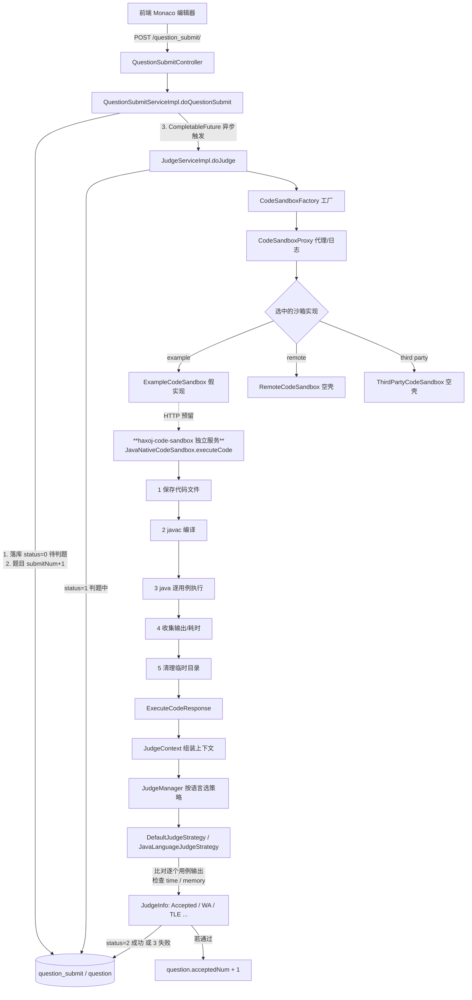
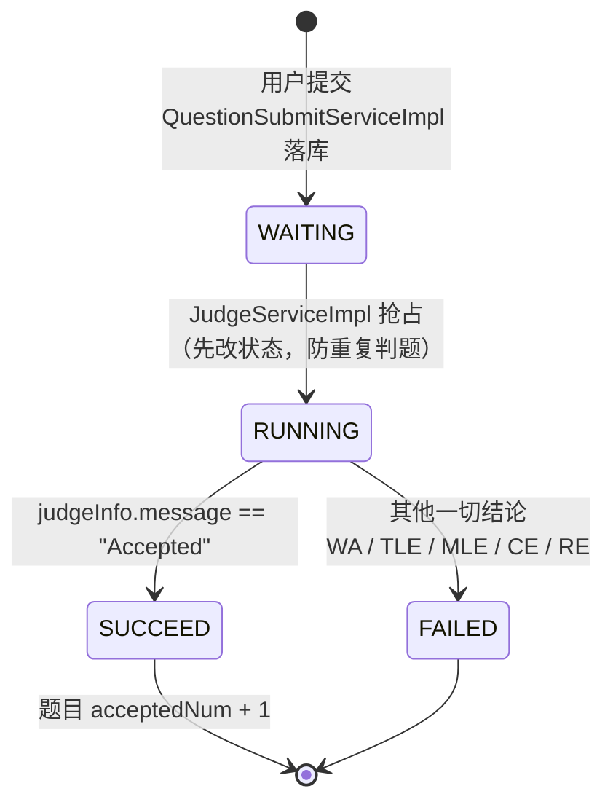
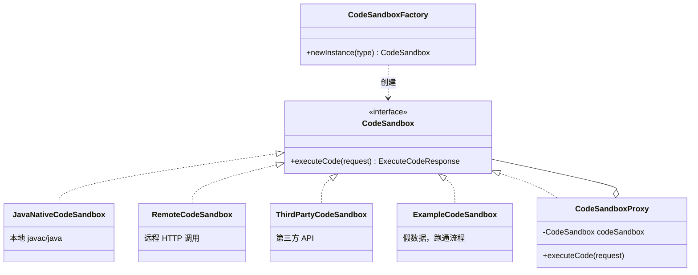
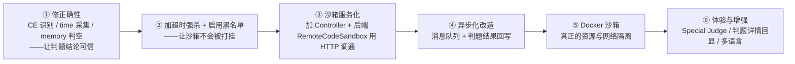

# 判题功能全景解析

> 日期：2026-09-17
> 范围：`haxoj-code-sandbox`（代码沙箱模块）+ `haxoj-backend/judge`（判题调度模块）
> 定位：**核心功能总览文档**——用于日后回顾、他人接手时快速建立整体认知
> 阅读建议：先看第 0、1 节建立全局观，第 3、4 节是主干，第 7、8 节是"真相与坑"（最容易被忽略、也最有价值）

---

## 0. 先看全局：判题到底在做什么

OJ（Online Judge）的判题，本质只有三件事：

```
① 把不可信的用户代码，放进一个可控环境里跑起来
② 把题目预设的测试输入喂进去，拿到实际输出
③ 拿实际输出和标准答案逐一比对 + 检查时间/内存，给出结论
```

三件事分别对应三个系统角色，**这是整个架构最核心的一条分界线**：

| 角色 | 项目 | 职责 | 关键原则 |
|---|---|---|---|
| **业务编排层** | `haxoj-backend` | 提交、状态流转、比对答案、落库、计数 | 管"判"，不管"跑" |
| **执行层（沙箱）** | `haxoj-code-sandbox` | 编译、执行、收集输出 | 管"跑"，不管"对错" |
| **展示层** | `haxoj-frontend` | 提交代码、轮询/展示判题结果 | 只消费结果 |

> **最重要的一句话**：沙箱**只负责执行，不判断对错**。它返回的是"程序输出了什么"，而不是"答案对不对"。
> 所有"对/错/超时/超内存"的结论，全部由主后端的判题策略层给出。
> 这条界线划清楚了，整个链路就通透了。

### 端到端一张图



---

## 1. 为什么要单独拆一个"代码沙箱"服务

新手最容易问的问题：**为什么不在主后端直接 `Runtime.exec` 跑用户代码？**

因为用户提交的代码是**完全不可信代码**。一旦和业务服务跑在同一个 JVM 里，用户可以：

- `System.exit(0)` 直接把你的后端干挂
- 无限循环 → 占满 CPU
- 疯狂 new 对象 → 吃光内存 → OOM 拖垮整个服务
- `Runtime.exec("rm -rf /")` / `Files.delete(...)` → 删你的库、你的配置文件
- 读取 `application.yml`、数据库密码、内网地址

拆成独立服务的收益：

| 收益 | 说明 |
|---|---|
| **故障隔离** | 沙箱崩了只影响判题，主站照常运行 |
| **资源隔离** | 沙箱可以单独限 CPU / 内存 / 磁盘，甚至可以单独部署到另一台机器 |
| **单一职责** | 沙箱只暴露"给代码+输入 → 还输出"这一件事，接口极简 |
| **可替换** | 想知道判题慢在哪、想换 Docker 方案、想接第三方，主后端**一行判题逻辑都不用改** |
| **跨语言扩展** | 换成 C++/Go，只在沙箱内部加分支；判题策略层按语言分派 |

> 一句话：**沙箱是一个"可插拔的执行引擎"，主后端只依赖它的接口，不依赖它的实现。**

---

## 2. 数据契约：四个模型撑起整条链路

判题链路上所有模块之间的通信，只靠下面这几个 Java 类。**读懂它们 = 读懂判题。**

### 2.1 `ExecuteCodeRequest` —— 请求：把什么交给沙箱

```java
public class ExecuteCodeRequest {
    private String code;             // 用户提交的源代码（一整个字符串）
    private String language;         // 语言标识："java" / "c++" / "golang"
    private List<String> inputList;  // 每个测试用例的输入，一个元素 = 一次运行
}
```

> 注意 `inputList` 是 **List**，不是单个 String。这意味着**一个用例一次进程**，
> 沙箱会对每个输入都完整跑一遍程序（而不是把一个进程喂多组输入）。

### 2.2 `ExecuteCodeResponse` —— 响应：沙箱还回来什么

```java
public class ExecuteCodeResponse {
    private List<String> outputList;  // 每个用例的实际输出，下标与 inputList 一一对应 ← 关键
    private String message;           // 执行过程中的错误信息（编译错误、运行错误堆栈）
    private Integer status;           // 沙箱自身的执行状态，见下表
    private JudgeInfo judgeInfo;      // 耗时、内存等原始指标
}
```

`status` 三种取值（定义在 `JavaNativeCodeSandbox`）：

| status | 含义 | 谁来置位 |
|---|---|---|
| `1` | 正常执行完成 | 所有用例都跑完了 |
| `2` | **沙箱自身出错**（系统问题，不是用户代码问题） | `getErrorResponse()` |
| `3` | **用户代码执行出错**（编译失败/抛异常） | 某个用例的 `errorMessage` 非空 |

> ⚠️ 这里 `status` 的语义是"沙箱执行结果"，跟数据库里 `QuestionSubmit.status`（0 待判题 / 1 判题中 / 2 成功 / 3 失败）**完全是两套东西**。见第 8.4 节，现在有混用。

### 2.3 `ExecuteMessage` —— 沙箱内部的"进程级"中间产物

沙箱内部每跑一次进程，就产出一个 `ExecuteMessage`：

```java
public class ExecuteMessage {
    private Integer exitValue;    // 进程退出码，0 = 成功
    private String message;       // 标准输出（stdout）
    private String errorMessage;  // 标准错误（stderr）
    private Long time;            // 本次进程耗时（ms），由 StopWatch 统计
}
```

对应关系：**N 个 `ExecuteMessage` → 聚合 → 1 个 `ExecuteCodeResponse`**。
这个类是"进程视角"的，不对外暴露，是沙箱内部的零件。

### 2.4 `JudgeInfo` —— 判题指标 + 最终结论

```java
public class JudgeInfo {
    private String message;  // 最终结论："Accepted" / "Wrong Answer" / "Time Limit Exceeded" ...
    private Long memory;     // 消耗内存（KB）
    private Long time;       // 耗时（ms）
}
```

这个类**贯穿整条链路**：
沙箱填 time/memory → 后端策略层读 time/memory 做判断 → 再写回 message → 序列化成 JSON 存进 `question_submit.judge_info`。

### 2.5 结论枚举 `JudgeInfoMessageEnum`

判题结论是一套固定枚举（在 `haxoj-backend`），前端只认这几个值：

| 枚举 | 值（存库/传输） | 中文 |
|---|---|---|
| `ACCEPTED` | `Accepted` | 成功 |
| `WRONG_ANSWER` | `Wrong Answer` | 答案错误 |
| `COMPILE_ERROR` | `Compile Error` | 编译错误 |
| `MEMORY_LIMIT_EXCEEDED` | `Memory Limit Exceeded` | 内存溢出 |
| `TIME_LIMIT_EXCEEDED` | `Time Limit Exceeded` | 超时 |
| `PRESENTATION_ERROR` | `Presentation Error` | 展示错误 |
| `OUTPUT_LIMIT_EXCEEDED` | `Output Limit Exceeded` | 输出溢出 |
| `WAITING` | `Waiting` | 等待中 |
| `DANGEROUS_OPERATION` | `Dangerous Operation` | 危险操作 |
| `RUNTIME_ERROR` | `Runtime Error` | 运行错误 |
| `SYSTEM_ERROR` | `System Error` | 系统错误 |

> 现在**只有前 5 个真正会被赋值**，其余是预留的坑位。

---

## 3. 沙箱主干：`JavaNativeCodeSandbox.executeCode()` 五步拆解

这个方法是整个沙箱的心脏，注释里写明了五步，代码也是严格按这五步走的：

```
1) 把用户的代码保存为文件    → 2) 编译代码，得到 class 文件
   → 3) 执行代码，得到输出结果 → 4) 收集整理输出结果 → 5) 文件清理
```

### 第 1 步：保存代码为文件（目录隔离）

```java
String userDir = System.getProperty("user.dir");              // 项目根目录
String globalCodePathName = userDir + File.separator + "tmpCode";
if (!FileUtil.exist(globalCodePathName)) FileUtil.mkdir(globalCodePathName);

String userCodeParentPath = globalCodePathName + File.separator + UUID.randomUUID();  // ← 隔离关键
String userCodePath = userCodeParentPath + File.separator + "Main.java";
File userCodeFile = FileUtil.writeString(code, userCodePath, StandardCharsets.UTF_8);
```

**三个设计点**：

| 点 | 为什么 |
|---|---|
| 用 `UUID.randomUUID()` 做子目录名 | 并发提交时，多个用户的 `Main.java` 不会互相覆盖 |
| 固定文件名 `Main.java` | 约定：用户代码入口类必须叫 `Main`（题面要求） |
| 写入时显式指定 `UTF_8` | 不依赖系统默认编码，保证跨平台一致（详见编码笔记） |

最终目录形态：

```
haxoj-code-sandbox/tmpCode/25349ed6-5e3c-4008-8dd1-6a1e32fdac99/
    ├── Main.java       ← 用户源码
    └── Main.class      ← 编译产物
```

### 第 2 步：编译

```java
String compileCmd = String.format("javac -encoding utf-8 %s", userCodeFile.getAbsolutePath());
Process compileProcess = Runtime.getRuntime().exec(compileCmd);
ExecuteMessage executeMessage = ProcessUtils.runProcessAndGetMessage(compileProcess, "编译", Charset.forName("GBK"));
```

| 参数 | 作用 |
|---|---|
| `-encoding utf-8` | 告诉 javac：**源文件**是 UTF-8 编码的 |
| 读取用 `GBK` | javac 的**错误信息**在 Windows 中文系统上是 GBK 输出（不是 UTF-8！） |

> 这两个"utf-8"和"GBK"看着矛盾，其实管的是两件独立的事：前者管源文件怎么读，后者管错误信息怎么读。
> 完整推导过程见 → [Java 编码问题总结](./2026-09-17_Java编码问题总结.md)

### 第 3 步：逐用例执行

```java
for (String input : executeCodeRequest.getInputList()) {
    String runCmd = String.format("java -Dfile.encoding=UTF-8 -cp %s Main %s", userCodeParentPath, input);
    Process runProcess = Runtime.getRuntime().exec(runCmd);
    ExecuteMessage executeMessage = ProcessUtils.runInteractProcessAndGetMessage(runProcess, input);
    executeMessageList.add(executeMessage);
}
```

| 参数 | 作用 |
|---|---|
| `-cp <父目录>` | 指定 classpath 到 UUID 目录，才能找到 `Main.class` |
| `-Dfile.encoding=UTF-8` | 强制用户程序用 UTF-8 输出（解决中文乱码） |
| `Main %s` | 注意：**输入并没有通过命令行参数传进去**（虽然拼了，但走的是下面的 stdin 方式） |

**关键机制：伪交互式输入**

用户代码通常用 `Scanner(System.in)` 读输入，所以必须把测试数据**写进子进程的标准输入**：

```java
// ProcessUtils.runInteractProcessAndGetMessage
OutputStream outputStream = runProcess.getOutputStream();       // 拿到子进程的 stdin
OutputStreamWriter outputStreamWriter = new OutputStreamWriter(outputStream);
String[] s = args.split(" ");                                    // "1 2" → ["1", "2"]
String join = StrUtil.join("\n", s) + "\n";                      // → "1\n2\n"
outputStreamWriter.write(join);
outputStreamWriter.flush();                                      // 相当于按了回车
```

> 为什么是 `split(" ")` + `join("\n")`？
> 因为用例输入在库里存成一行字符串（如 `"1 2"`），但用户代码里通常是**两次 `nextInt()`**，
> 中间需要换行分隔。所以把空格拆开、用换行重连，模拟用户逐行输入。

**资源释放顺序很重要**（注释也点明了"记得资源的释放，否则会卡死"）：

```java
outputStreamWriter.close();
outputStream.close();
inputStream.close();
runProcess.destroy();
```

### 第 4 步：收集整理

```java
ExecuteCodeResponse executeCodeResponse = new ExecuteCodeResponse();
List<String> outputList = new ArrayList<>();
long maxTime = 0;                                       // 取最大值，便于判断是否超时
for (ExecuteMessage executeMessage : executeMessageList) {
    String errorMessage = executeMessage.getErrorMessage();
    if (StrUtil.isNotBlank(errorMessage)) {
        executeCodeResponse.setMessage(errorMessage);
        executeCodeResponse.setStatus(3);               // 用户代码执行出错
        break;                                          // 有一个出错就中断
    }
    outputList.add(executeMessage.getMessage());
    Long time = executeMessage.getTime();
    if (time != null) maxTime = Math.max(maxTime, time);
}
if (outputList.size() == executeMessageList.size()) {
    executeCodeResponse.setStatus(1);                   // 全部正常跑完
}
```

**聚合规则**：

| 情况 | outputList | status |
|---|---|---|
| 全部用例正常 | N 个输出，与输入一一对应 | `1` |
| 某用例抛异常 / 编译失败 | 只有出错前的那几个 | `3` |
| 沙箱自身异常（`IOException`） | 空 | `2` |

> 隐含逻辑：**outputList 的长度就是"成功跑完的用例数"**。
> 上层策略层就是靠"长度不匹配"来判断有问题的（见 4.3 节）。

### 第 5 步：清理

```java
if (userCodeFile.getParentFile() != null) {
    boolean del = FileUtil.del(userCodeParentPath);     // 整个 UUID 目录删掉
}
```

**坑**：这段清理只在"正常走完第 4 步"时执行。
前面所有 `return getErrorResponse(e)` 的早退路径，以及 `ProcessUtils` 里抛出的 `RuntimeException`，
**都不会走到这里 → 临时目录残留**（`tmpCode/` 下现在就有不少只含 `Main.java` 的孤儿目录）。

---

## 4. 上层链路：从"提交"到"落库"

### 4.1 提交入口（异步化的起点）

`QuestionSubmitServiceImpl.doQuestionSubmit()`：

```java
// 1. 校验：题目 id > 0、语言合法（java / c++ / golang）、题目存在、用户已登录
// 2. 落库：状态置为 0（WAITING 待判题）
questionSubmit.setStatus(QuestionSubmitStatusEnum.WAITING.getValue());
this.save(questionSubmit);

// 3. 题目提交数 +1（用 synchronized 块 + 读后写）
synchronized (this) {
    Question updateQuestion = new Question();
    updateQuestion.setId(questionId);
    updateQuestion.setSubmitNum(question.getSubmitNum() + 1);
    questionService.updateById(updateQuestion);
}

// 4. 异步触发判题 —— 不阻塞用户请求
Long questionSubmitId = questionSubmit.getId();
CompletableFuture.runAsync(() -> {
    judgeService.doJudge(questionSubmitId);
});
return questionSubmitId;                     // 立刻把提交 id 返回给前端
```

**为什么必须异步？** 判题要跑 JVM、要编译、可能好几秒。同步做的话，用户点"提交"后浏览器会一直转圈。
所以这里**先落库、立刻返回 id，判题在后台线程池里跑**，前端拿 id 去轮询结果。

> 循环依赖处理：`QuestionSubmitServiceImpl` 和 `JudgeServiceImpl` 互相依赖，
> 用 `@Lazy` 打破循环（Spring 先注入代理，真正调用时才查真实实例）。

### 4.2 判题主流程：`JudgeServiceImpl.doJudge()`

这是"判题总指挥"，八步走：

```java
// ① 校验提交记录、题目是否存在
// ② 防重复：status == 1(判题中) 直接抛异常
// ③ 加锁：把状态改为 1（判题中），防止重复执行
questionSubmitUpdate.setStatus(QuestionSubmitStatusEnum.RUNNING.getValue());
questionSubmitService.updateById(questionSubmitUpdate);

// ④ 调沙箱：工厂 + 代理
CodeSandbox codeSandbox = CodeSandboxFactory.newInstance(type);  // type 来自 application.yml
codeSandbox = new CodeSandboxProxy(codeSandbox);                  // 套一层日志代理

ExecuteCodeRequest executeCodeRequest = new ExecuteCodeRequest();
executeCodeRequest.setCode(questionSubmit.getCode());
executeCodeRequest.setLanguage(questionSubmit.getLanguage());

// ⑤ 从题目里解析测试用例，把 input 抽出来
List<JudgeCase> judgeCaseList = JSONUtil.toList(question.getJudgeCase(), JudgeCase.class);
List<String> inputList = judgeCaseList.stream().map(JudgeCase::getInput).collect(Collectors.toList());
executeCodeRequest.setInputList(inputList);

// ⑥ 执行
ExecuteCodeResponse executeCodeResponse = codeSandbox.executeCode(executeCodeRequest);

// ⑦ 组装上下文 → 交给策略层判定
JudgeContext judgeContext = new JudgeContext();
judgeContext.setJudgeInfo(executeCodeResponse.getJudgeInfo());
judgeContext.setQuestion(question);
judgeContext.setQuestionSubmit(questionSubmit);
judgeContext.setInputList(inputList);
judgeContext.setOutputList(executeCodeResponse.getOutputList());
judgeContext.setJudgeCaseList(judgeCaseList);

JudgeManager judgeManager = new JudgeManager();
JudgeInfo judgeInfo = judgeManager.doJudge(judgeContext);

// ⑧ 落库：Accepted → status=2(成功)，其他 → status=3(失败)
QuestionSubmitStatusEnum statusEnum = JudgeInfoMessageEnum.ACCEPTED.getValue().equals(judgeInfo.getMessage())
        ? QuestionSubmitStatusEnum.SUCCEED : QuestionSubmitStatusEnum.FAILED;
questionSubmitUpdate.setStatus(statusEnum.getValue());
questionSubmitUpdate.setJudgeInfo(JSONUtil.toJsonStr(judgeInfo));
questionSubmitService.updateById(questionSubmitUpdate);

// ⑨ 通过则题目通过数 +1（原子 SQL，避免并发丢更新）
if (QuestionSubmitStatusEnum.SUCCEED.equals(statusEnum)) {
    questionUpdateWrapper.setSql("acceptedNum = acceptedNum + 1");
}
```

> **两个计数器的写法差异值得记住**：
> - `submitNum + 1` 是"读出来 +1 再写回"，靠 `synchronized` 兜底（有风险，见 8.6）
> - `acceptedNum + 1` 是 `setSql("acceptedNum = acceptedNum + 1")`，**交给数据库做原子自增**，天然线程安全 ✅

### 4.3 策略层：对错到底怎么判（`DefaultJudgeStrategy`）

顺序判断，**任一不通过立即返回**：

```java
JudgeInfoMessageEnum judgeInfoMessageEnum = JudgeInfoMessageEnum.ACCEPTED;

// 判断 1：输出数量对不对
if (outputList.size() != inputList.size())  → Wrong Answer

// 判断 2：逐个用例比对（字符串全等，比较严格）
for (int i = 0; i < judgeCaseList.size(); i++) {
    if (!judgeCase.getOutput().equals(outputList.get(i)))  → Wrong Answer
}

// 判断 3：内存超限
if (memory > needMemoryLimit)  → Memory Limit Exceeded

// 判断 4：时间超限
if (time > needTimeLimit)      → Time Limit Exceeded

// 全过 → Accepted
```

**Java 专属策略 `JavaLanguageJudgeStrategy` 的唯一区别**：

```java
long JAVA_PROGRAM_TIME_COST = 10000L;
if ((time - JAVA_PROGRAM_TIME_COST) > needTimeLimit) → Time Limit Exceeded
```

> 给 Java 程序**白送 10 秒**。原因很朴素：JVM 启动 + 类加载 + JIT 预热本身就吃掉大量时间，
> 用同一套时间限制去卡 Java 和 C++ 是不公平的。这是"同一份判题逻辑，按语言微调"的典型场景。

**比较的严格性**：现在用的是 `String.equals` —— **完全字符串相等**。
这意味着：
- 行尾多一个空格 → Wrong Answer
- 多个空行 → Wrong Answer
- 浮点误差（`0.3333333` vs `0.33333333333`）→ Wrong Answer

专业 OJ 会做 trim + 忽略行尾空白 + 浮点容差（Special Judge），这块目前是缺失的。

---

## 5. 状态机：一次提交的生命周期



| 状态 | 值 | 触发点 |
|---|---|---|
| 待判题 WAITING | `0` | `doQuestionSubmit` 落库时 |
| 判题中 RUNNING | `1` | `doJudge` 开始时（用来防重复） |
| 成功 SUCCEED | `2` | 结论是 `Accepted` |
| 失败 FAILED | `3` | 其余全部结论 |

> **设计亮点**：进入判题前先把状态改成 `1`，如果同一提交被触发两次，第二次会因为"状态 == 1"直接被拒。
> 这是**乐观锁思想**的一个简化版——用状态位做幂等保护。
> （更严谨的做法是 `UPDATE ... WHERE status = 0` 判断影响行数，这样是原子的，不存在检查与更新之间的窗口期。）

---

## 6. 两个可插拔点：设计模式落地

整个判题功能的扩展性，只押在两个"接口 + 工厂"上。

### 6.1 可插拔点一：沙箱实现（工厂 + 代理）

```java
// 接口：所有沙箱都长这样
public interface CodeSandbox {
    ExecuteCodeResponse executeCode(ExecuteCodeRequest request);
}
```



**切换沙箱只需要改一行配置**（`application.yml`）：

```yaml
codesandbox:
  type: example      # example / remote / third party
```

| type | 实现 | 现状 |
|---|---|---|
| `example` | `ExampleCodeSandbox` | ✅ **当前正在用**。直接把输入当输出返回，用于跑通链路 |
| `remote` | `RemoteCodeSandbox` | ⚠️ 空壳，只 `println` 后 `return null` |
| `third party` | `ThirdPartyCodeSandbox` | ⚠️ 空壳 |

**代理类 `CodeSandboxProxy` 的作用**：统一打日志（请求/响应），且不改动任何真实实现。
这是标准的"静态代理"，后续想加**耗时统计、重试、熔断**，都往这一层塞，不用碰业务代码。

### 6.2 可插拔点二：判题策略（策略模式）

```java
// JudgeManager —— 按语言分派
JudgeStrategy judgeStrategy = new DefaultJudgeStrategy();
if ("java".equals(language)) {
    judgeStrategy = new JavaLanguageJudgeStrategy();   // Java 有 10s 宽限
}
return judgeStrategy.doJudge(judgeContext);
```

`JudgeContext` 是**上下文对象（Context）**，把策略需要的所有输入打包成一个"参数袋"：

```java
public class JudgeContext {
    private JudgeInfo judgeInfo;              // 沙箱给的 time / memory
    private List<String> inputList;           // 输入
    private List<String> outputList;          // 实际输出
    private List<JudgeCase> judgeCaseList;    // 题目标准用例（含期望输出）
    private Question question;                // 题目（含 judgeConfig 限制）
    private QuestionSubmit questionSubmit;    // 提交记录（含 language）
}
```

> 用 Context 而不是把 6 个参数平铺进方法签名，好处是：
> **以后新增策略需要的字段，只改 Context 类，不用改所有策略的方法签名。**

---

## 7. 当前真实进度：哪些通了，哪些还只是壳

这一节是最容易"想当然"的地方，实际对着代码看：

| 模块 | 状态 | 证据 |
|---|---|---|
| 沙箱本地执行引擎 | ✅ **代码完整可跑** | `JavaNativeCodeSandbox.executeCode` 五步齐全，且能用 `main` 方法手动跑通 |
| 沙箱对外 HTTP 接口 | ❌ **完全不存在** | `haxoj-code-sandbox` 里**没有任何 `Controller`**，只有 `CodeSandbox` 接口 + 实现 + 工具类 |
| 后端 → 沙箱的连接 | ❌ **断开** | `RemoteCodeSandbox` 是空壳；`CodeSandboxFactory` 里也没有"指向本地沙箱"的选项 |
| 后端判题全链路 | ✅ **用假沙箱跑通** | `codesandbox.type: example`，`ExampleCodeSandbox` 返回假数据 |
| 判题策略层 | ✅ 已实现 | `DefaultJudgeStrategy` + `JavaLanguageJudgeStrategy` |
| 编译错误识别 | ❌ **缺失** | 编译失败不会产生 `Compile Error` 结论（详见 8.1） |
| 时间/内存限制 | ❌ **未真正生效** | 详见 8.2 / 8.3 |
| 安全沙箱（黑名单 / SecurityManager） | ❌ **未实现** | 详见 8.5 |

**一句话总结现状**：
> **"判题的骨架已经搭好、链路已经跑通，但真正执行的那一环还是假的。"**
> 目前 `JavaNativeCodeSandbox` 是一个**能独立运行、但还没接进系统**的组件。
> 下一步的核心工作量，就是把"沙箱独立服务化"这个缺口补上（→ 见第 9 节）。

---

## 8. 问题清单（按严重程度排序）

> 这部分是**技术债台账**，也是"下次打开项目该先修什么"的答案。

### 8.1 🔴 编译错误会被误判为「答案错误」

**现象**：用户代码有语法错误，最终看到的是 `Wrong Answer`，而不是 `Compile Error`。

**原因链**：

```
编译失败 → executeMessage.errorMessage 非空
        → 但第 2 步只 System.out.println，没有写进 response / 没有提前返回
        → 继续执行 "java Main" → 找不到 class → 进程报错
        → 第 4 步 status=3，message="找不到主类..."
        → 策略层只比"输出数量" → 0 != N → Wrong Answer
```

**修复方向**：编译步骤判断 `executeMessage.getErrorMessage()` 非空时，
直接返回 status=3 且 `judgeInfo.message = Compile Error`；
策略层改为**优先读 `ExecuteCodeResponse.status` / `message`** 来决定是 CE 还是 RE，再进入答案比对。

### 8.2 🔴 时间限制永远不会触发（且会 NPE）

**原因**：第 3 步实际调用的是 `runInteractProcessAndGetMessage`，而这个方法**从头到尾没有 `setTime()`**。

```java
// ProcessUtils.runInteractProcessAndGetMessage —— 只设置了 message
executeMessage.setMessage(compileOutputStringBuilder.toString());
// ❌ 没有 executeMessage.setTime(...)
```

连锁反应：

```
time == null → 沙箱里 maxTime 保持 0 → judgeInfo.setTime(0L)
             → JavaLanguageJudgeStrategy: (0 - 10000) > needTimeLimit → false
             → 时间判断永远通过 ✅（永远不超时）
```

**修复方向**：在 `runInteractProcessAndGetMessage` 里也用 `StopWatch` 统计并 `setTime()`。

### 8.3 🔴 内存限制会直接 NPE（切换到真实沙箱后必崩）

`JavaNativeCodeSandbox` 里这段是空实现：

```java
// 要借助第三方库来获取内存占用，非常麻烦，此处不做实现
// judgeInfo.setMemory();
```

于是 `judgeInfo.memory == null`，而策略层做的是：

```java
Long memory = judgeInfo.getMemory();      // null
if (memory > needMemoryLimit)             // ← 自动拆箱 → NullPointerException
```

**当前没炸的原因**：用的是 `ExampleCodeSandbox`，它硬编码了 `setMemory(100L)` 和 `setTime(100L)`。
**一旦把 `codesandbox.type` 换成真实沙箱，判题立刻 500。**

**修复方向**（两条都要做）：
1. 沙箱侧：用 `OperatingSystemMXBean` 或 `ProcessHandle` 采集内存，赋给 `judgeInfo.memory`
2. 策略侧：**防御性判空**（`memory != null && memory > limit`），不要让"指标缺失"变成"系统崩溃"

### 8.4 🟡 两套 `status` 语义混用

`ExampleCodeSandbox` 里：

```java
executeCodeResponse.setStatus(QuestionSubmitStatusEnum.SUCCEED.getValue());  // = 2
```

但 `ExecuteCodeResponse.status` 的语义应该是"沙箱执行结果"（1 正常 / 2 沙箱错误 / 3 用户代码错误），
跟 `QuestionSubmitStatusEnum`（0/1/2/3 表示提交状态）**不是一回事**。这里用 `2` 恰好数值相同，
所以暂时没暴露问题，但语义已经污染了。

**修复方向**：给沙箱结果单独定义枚举 `ExecuteStatusEnum { SUCCESS=1, SANDBOX_ERROR=2, USER_ERROR=3 }`。

### 8.5 🔴 安全防护尚未生效（骨架已搭，开关全关）

沙箱主类里和安全相关的三个字段，目前都还是摆设：

```java
private static final String SECURITY_MANAGER_PATH =
        "C:\\code\\yuoj-code-sandbox\\src\\main\\resources\\security";  // ← 教程残留路径，本机不存在
private static final String SECURITY_MANAGER_CLASS_NAME = "MySecurityManager";
private static final List<String> blackList = Arrays.asList("Files", "exec");  // ← 定义了但从未使用
// private static final WordTree WORD_TREE;                                     // ← 整行被注释掉
```

`security/` 包下已经写了三个安全管理器，但都还是**观察/演示**性质：

| 类 | 实际行为 | 用途 |
|---|---|---|
| `DefaultSecurityManager` | `checkPermission` 只 `println(perm)`，**不调 super** → 全部放行 | 观察程序会申请哪些权限 |
| `DenySecurityManager` | `checkPermission` 直接 `throw SecurityException` | 演示"全部拒绝" |
| `MySecurityManager` | 六个 `checkXxx` 方法体全被注释，仅 `checkRead` 里留了 `println(file)` → 全部放行 | 观察程序会读哪些文件 |

> **关键认知：`checkPermission` 里不调 `super.checkPermission(perm)`，就等于没有任何限制。**
> SecurityManager 的默认语义是"检查不过就抛异常"；把 super 去掉、把 throw 注释掉，
> 它就从"门禁"退化成"监控摄像头"。
> 且 `SECURITY_MANAGER_PATH` / `SECURITY_MANAGER_CLASS_NAME` 这两个常量**从头到尾没被读取过**，
> 也就是说这三个类**一个都没真正接进 `JavaNativeCodeSandbox`**。

**现状**：用户代码可以自由 `System.exit()`、`Runtime.exec()`、读写文件、无限循环。
**目前唯一的"安全"是：用户代码还没被打包上传到公网。**

> ⚠️ 另一个隐蔽点：`MySecurityManager.checkRead` 里那句 `System.out.println(file)` 会把
> **每一次文件/类的读取**都打出来。一旦把它接进沙箱，控制台会被几百行 `.class`、`.jar`
> 路径淹没（真正的写入信息会被埋在中间）。上线前要么删掉 println，要么用日志级别控制。

**修复方向（按性价比排序）**：
1. **超时强杀**（最紧急，防死循环打挂服务器）→ `waitFor(timeout, unit)` + `destroyForcibly()`
2. **黑名单词法校验**（`WordTree` 本身就支持，代码已备好，只差启用）
3. **自定义 SecurityManager**（Java 8 可用；注意 Java 17+ 已废弃，届时需改用 Docker/进程隔离方案）
4. **最终方案：Docker 容器隔离**（限 CPU / 内存 / 网络 / 文件系统）

### 8.6 🟡 其他待改进点

| # | 问题 | 说明 | 建议 |
|---|---|---|---|
| 1 | **无超时强杀** | `TIME_OUT = 5000L` 定义了却没用；`runProcess.waitFor()` 会无限等待 | `waitFor(5, SECONDS)` 超时后 `destroyForcibly()` |
| 2 | **`synchronized(this)` 锁不可靠** | 只锁住单实例；集群部署下失效，且锁粒度过大 | 改用 SQL：`UPDATE question SET submitNum = submitNum + 1 WHERE id = ?` |
| 3 | **异步判题无持久化** | `CompletableFuture.runAsync` 用默认 ForkJoinPool，服务重启 → 判题任务丢失 | 引入消息队列（RabbitMQ）+ 死信重试，或加"启动时扫描 WAITING 记录"补偿任务 |
| 4 | **`JudgeManager` 手动 new** | 标了 `@Service` 却在 `JudgeServiceImpl` 里 `new JudgeManager()` | 改为 `@Resource` 注入 |
| 5 | **每个用例重启一次 JVM** | N 个用例 = N 次 JVM 启动（每次约 100ms+），性能差 | 通用做法；如需优化可合并用例或引入常驻判题进程 |
| 6 | **答案比对过于严格** | `String.equals` 全等，末尾空格/空行/浮点误差都会 WA | 加 `trim()`、忽略行尾空白、支持 Special Judge |
| 7 | **`Runtime.exec(String)` 单字符串** | 内部按空格拆参，路径含空格会出错 | 改用 `ProcessBuilder(List<String>)` |
| 8 | **早退路径不清理临时目录** | 异常 return 时 `tmpCode` 残留，长期会占满磁盘 | `try/finally` 包裹清理逻辑 |
| 9 | **`INPUT` 双重传递** | `runCmd` 里拼了 `input`，同时又走 stdin 写了一遍 | 二者留一即可（保留 stdin 方式） |
| 10 | **判题中重复提交是抛异常** | 体验上不如"幂等返回已有结果" | 视业务需要调整 |
| 11 | **临时目录位置依赖 `user.dir`** | `System.getProperty("user.dir")` 取的是 JVM 的**工作目录**，它随运行方式变化（IDE 运行配置 / jar 启动 / 服务启动各不相同）→ `tmpCode` 会跑到意想不到的地方 | 改成从 `application.yml` 读一个**绝对路径**，如 `codesandbox.tmp-code-path` |

---

## 9. 下一步路线图（建议顺序）



**优先级理由**：

- **①②先做**：判题结论不可信、服务能被一行死循环打挂，这两个是"功能是否算能用"的底线，且改动量很小。
- **③再做**：这才是"沙箱模块真正被用起来"的那一步，也是从"示例项目"走向"完整项目"的关键分水岭。
- **④⑤⑥后做**：属于规模化与生产级需求，等 ③ 跑稳之后再投入。

**③ 的具体落地要点**：
1. `haxoj-code-sandbox` 加 `CodeSandboxController`，暴露 `POST /executeCode`
2. 把 `JavaNativeCodeSandbox` 注册成 Spring Bean（而非只能 `new`）
3. 后端 `RemoteCodeSandbox` 用 `RestTemplate`/`Hutool HttpUtil` 调用该地址
4. `CodeSandboxFactory` 增加 `"java native"` / `"remote"` 分支，`application.yml` 切换
5. 沙箱服务单独部署（同机不同端口 / 不同机器），并加**内网鉴权**（不能裸奔在公网）

---

## 10. 速查表

### 10.1 文件职责索引

| 文件 | 职责 | 一句话 |
|---|---|---|
| `haxoj-code-sandbox/CodeSandbox.java` | 沙箱接口 | 「执行引擎」的统一契约 |
| `haxoj-code-sandbox/JavaNativeCodeSandbox.java` | 本地 Java 沙箱 | 五步执行主干（**当前唯一真实实现**） |
| `haxoj-code-sandbox/utils/ProcessUtils.java` | 进程工具 | 启进程、喂输入、收输出、算耗时 |
| `haxoj-code-sandbox/model/*.java` | 沙箱数据模型 | Request / Response / ExecuteMessage / JudgeInfo |
| `haxoj-backend/judge/JudgeService.java` | 判题服务接口 | 对外只暴露 `doJudge(id)` |
| `haxoj-backend/judge/JudgeServiceImpl.java` | 判题总指挥 | 状态流转 + 调沙箱 + 调策略 + 落库 |
| `haxoj-backend/judge/codesandbox/CodeSandboxFactory.java` | 沙箱工厂 | 按配置创建沙箱实例 |
| `haxoj-backend/judge/codesandbox/CodeSandboxProxy.java` | 沙箱代理 | 统一日志，可扩展熔断/重试 |
| `haxoj-backend/judge/codesandbox/impl/*.java` | 三种沙箱实现 | example ✅ / remote ❌ / third party ❌ |
| `haxoj-backend/judge/strategy/JudgeManager.java` | 策略分派 | 按语言选策略 |
| `haxoj-backend/judge/strategy/JudgeContext.java` | 上下文参数袋 | 策略的输入集合 |
| `haxoj-backend/judge/strategy/DefaultJudgeStrategy.java` | 默认判题策略 | 数量 → 逐用例 → 内存 → 时间 |
| `haxoj-backend/judge/strategy/JavaLanguageJudgeStrategy.java` | Java 判题策略 | 同默认，但时间宽限 10s |

### 10.2 术语表

| 缩写 | 全称 | 含义 |
|---|---|---|
| **AC** | Accepted | 通过 |
| **WA** | Wrong Answer | 答案错误 |
| **CE** | Compile Error | 编译错误 |
| **TLE** | Time Limit Exceeded | 超时 |
| **MLE** | Memory Limit Exceeded | 超内存 |
| **RE** | Runtime Error | 运行时错误（抛异常、除零、越界） |
| **SE** | System Error | 判题系统自身故障 |
| **Judge Case** | 判题用例 | 一组 `{input, output}` |
| **Judge Config** | 判题配置 | `{timeLimit, memoryLimit, stackLimit}` |
| **沙箱 Sandbox** | 代码执行环境 | 隔离运行不可信代码的容器 |

### 10.3 关键坐标（便于 Ctrl+F 定位）

| 想找什么 | 去哪 |
|---|---|
| 保存代码 / UUID 目录 | `JavaNativeCodeSandbox` 第 1 步 |
| 编译命令 / 编码参数 | `JavaNativeCodeSandbox` 第 2 步 |
| 交互式喂输入 | `ProcessUtils.runInteractProcessAndGetMessage` |
| 进程耗时统计 | `ProcessUtils.runProcessAndGetMessage`（`StopWatch`） |
| 判题状态流转 | `JudgeServiceImpl.doJudge` |
| 对错比对逻辑 | `DefaultJudgeStrategy.doJudge` |
| 结论枚举定义 | `JudgeInfoMessageEnum` |
| 沙箱选择配置 | `haxoj-backend/src/main/resources/application.yml` → `codesandbox.type` |
| 临时代码目录 | `haxoj-code-sandbox/tmpCode/` |

---

## 11. 一句话总结

> **判题 = 沙箱执行 + 策略判定。**
> 沙箱（`haxoj-code-sandbox`）负责把不可信代码安全地跑起来、拿到输出，**不判断对错**；
> 主后端（`haxoj-backend/judge`）负责编排状态、比对答案、给结论、落库计数。
> 两者通过 `ExecuteCodeRequest` / `ExecuteCodeResponse` 这一对模型解耦，通过**工厂 + 代理 + 策略**三个模式实现可插拔。
> **当前进度：链路已通，但执行环节仍是示例实现；补齐"编译错误识别、时间采集、内存判空、超时强杀"四项正确性修复，并完成沙箱服务化，判题功能才算真正可用。**
