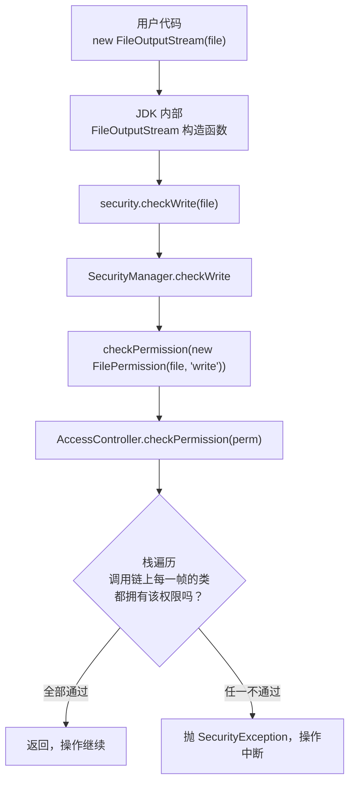
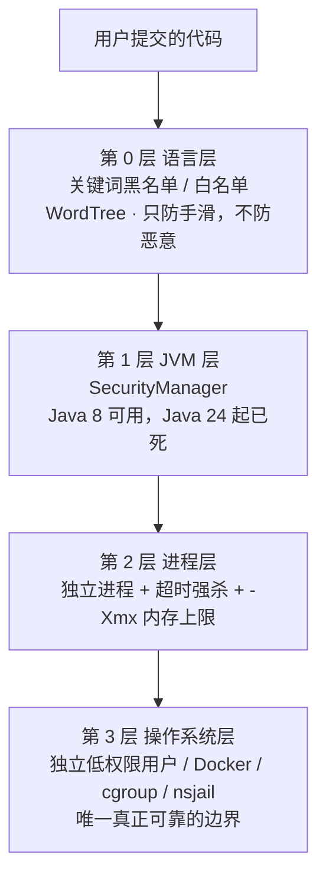

> 日期：2026-09-18
> 主题：Java 安全管理器（SecurityManager）—— 原理、实测、现状与替代方案
> 环境：corretto-1.8.0_432（JDK 8）+ Windows；文中标注了各版本差异
> 关联：[判题功能全景解析](./2026-09-17_判题功能全景解析.md) · [Java 编码问题总结](./2026-09-17_Java编码问题总结.md)

---

## 1. 先给结论

| 问题 | 结论 |
|---|---|
| 它是什么 | JVM 内部的一个**权限检查器**，被 JDK 源码在敏感操作前主动调用 |
| 它怎么拦 | 调用链上有任何一个检查点抛 `SecurityException`，操作就失败 |
| 它是不是沙箱 | **不是**。它只是"门禁"，同进程内的一层检查，挡不住 native 代码、挡不住自己卸载 |
| 它管什么 | 文件读写、执行命令、网络连接、JVM 退出、类加载/反射、系统属性、线程操作 |
| 它**不**管什么 | CPU 时间（死循环）、内存分配、线程数爆炸、文件句柄耗尽 —— 这些它完全看不见 |
| 现在还能用吗 | **Java 8 能，Java 17 弃用，Java 24 起永久禁用（JEP 486）** |
| 官方推荐替代 | 容器/进程隔离（containers），而不是在 JVM 内部做隔离 |
| 对本项目意义 | 沙箱跑在 Java 8，所以**技术上可用**；但它是多层防御里最弱的一层，不能单独承担 |

> 一句话认知：**SecurityManager 的设计目标是"防程序员手滑"，不是"防恶意攻击者"。** 用错场景是它被淘汰的根本原因。

---

## 2. 它要解决什么问题

假如 Java 有一个"下载别人的 jar 直接跑"的场景 —— 比如浏览器里的 Applet、或者一个允许用户上传代码的判题系统。你希望这段**不可信代码**：

- 可以读自己的输入、写自己的输出
- 不能读 `/etc/passwd`、不能删你的文件、不能 `Runtime.exec("rm -rf /")`、不能连外网

传统做法是操作系统级别的隔离（独立进程 + 低权限用户）。但 JDK 1.0 时代的设计者想：既然 JVM 已经管着所有字节码的执行，**能不能由 JVM 自己在每次碰到敏感操作时问一句"这个操作允许吗"**？

这就是 SecurityManager：**在 JVM 内部、按调用者身份做权限裁决**。这个概念叫"最小权限原则（Principle of Least Privilege）"的 JVM 实现。

---

## 3. 三个核心角色

理解 SecurityManager 只需要抓住三个类，缺一个都讲不通：

| 角色 | 类 | 职责 |
|---|---|---|
| 检查器 | `java.lang.SecurityManager` | 被 JDK 内部调用，决定放行还是抛异常 |
| 凭证 | `java.security.Permission` 及其子类 | 描述"要做什么事"，如 `FilePermission("/tmp/x", "write")` |
| 规则 | `java.security.Policy` | 决定"谁，拥有哪些 Permission"，默认从 `java.policy` 文件读 |

常见的 Permission 子类：

| Permission | 触发场景 |
|---|---|
| `FilePermission` | 读/写/删文件 |
| `RuntimePermission` | `exitVM`、`createClassLoader`、`setSecurityManager`、`modifyThread` |
| `SocketPermission` | 网络连接 |
| `PropertyPermission` | 读写 `System.getProperty()` |
| `ReflectPermission` | 反射访问私有成员 |

---

## 4. 它是怎么被触发的：调用链

关键认知：**SecurityManager 不是"拦住"操作，而是 JDK 在操作之前主动去问它。** 每一处敏感操作前，JDK 源码里都预先埋好了一句检查。



三个必须记住的点：

**① 默认实现是一条固定的链。** 如果你只 override `checkWrite`，那它就按你的逻辑走；如果你 override 了 `checkPermission`，那么所有**没有单独 override** 的 `checkXxx` 都会落到 `checkPermission` 上。

**② 核心机制是"栈遍历（stack inspection）"**，这是它最独特、也最贵的地方。它检查的不是"调用者有没有权限"，而是**当前线程整个调用栈上每一帧的类有没有权限**，任何一帧不通过就拒绝。这叫 fail-safe 设计。

> 正因为要遍历整个栈，才有 `AccessController.doPrivileged(...)` 这个 API —— 它的作用是**截断栈遍历**："我这段代码是可信的，别再往下查了。"

**③ 卸载点是致命的。** `System.setSecurityManager(null)` 本身就是一次权限检查（`RuntimePermission("setSecurityManager")`），但这个检查同样会走你自己的 `checkPermission`。

---

## 5. 实测：它到底长什么样

以下结论全部来自在本机（corretto-1.8.0_432）实际编译运行，不是推测。

### 5.1 实验一：一个"什么都不检查"的安全管理器

写一个把 `checkPermission` 留空的 SecurityManager，装上去之后依次读文件、写文件、执行命令、退出：

```java
public class ProbeSecurityManager extends SecurityManager {
    @Override
    public void checkPermission(Permission perm) {
        // 注意：没有调用 super.checkPermission(perm)
        System.out.println("[SM] checkPermission -> " + perm);
    }
    @Override public void checkWrite(String file) { System.out.println("[SM] checkWrite -> " + file); }
    // checkRead / checkExec / checkExit 同理，只打印不拦截
}
```

实测输出（有删减）：

```
== stage 1: after installing SM ==
   getSecurityManager = exp.ProbeSecurityManager@33909752
== stage 2: READ a file that does not exist ==
[SM] #1 checkRead -> no_such_file.txt
   read failed: FileNotFoundException
== stage 3: WRITE a file ==
[SM] #2 checkWrite -> hacked.txt
   write SUCCEEDED -> checkWrite did NOT block us
== stage 4: EXEC a shell command ==
[SM] #3 checkExec -> cmd
[SM] #4 checkPermission -> ("java.util.PropertyPermission" "jdk.lang.Process.allowAmbiguousCommands" "read")
[SM] #5 checkPermission -> ("java.lang.RuntimePermission" "writeFileDescriptor")
[SM] #6 checkPermission -> ("java.lang.RuntimePermission" "readFileDescriptor")
   exec SUCCEEDED, exitCode=0 -> checkExec did NOT block us
== stage 5: total access checks so far = 7 ==
```

三个直接可读的结论：

1. **`checkWrite` 确实被调用了**（`#2`），只是我们没拦 —— 证明检查点真实存在，钩子的位置是对的。
2. **一次 `Runtime.exec()` 不止触发 `checkExec`**，后面还跟了 3 次 `checkPermission`（进程创建需要的文件描述符、系统属性）。**一次敏感操作会连爆多个检查**。
3. 从安装到退出，总共只有 **7 次** 检查 —— 因为类加载都发生在安装之前。

### 5.2 实验二：把安全管理器交给命令行启动

用 `-Djava.security.manager=<类名>` 在 JVM 启动时安装，此时检查次数暴涨到 **58 次**：

```
== RUN C (-Djava.security.manager=exp.ProbeSecurityManager, 全限定名) rc=0 ==
[SM] #1  checkPermission -> ("java.util.PropertyPermission" "sun.boot.class.path" "read")
[SM] #3  checkPermission -> ("java.lang.RuntimePermission" "modifyThreadGroup")
...
[SM] #27 checkPermission -> ("java.util.PropertyPermission" "java.vm.specification.version" "read")
[SM] #34 checkPermission -> ("java.util.PropertyPermission" "java.library.path" "read")
[SM] #35 checkPermission -> ("java.util.PropertyPermission" "java.class.path" "read")
```

**这些几乎全是 JVM 自己引导时产生的**（读系统属性、管理线程组）。这就是 SecurityManager 性能开销的真实来源：它不只拦坏人，也拦 JVM 自己。

### 5.3 实验三：类名写错 = JVM 直接起不来

同一个类，用**简名**启动：

```
=== RUN B (-Djava.security.manager=ProbeSecurityManager) rc=1 ===
Error occurred during initialization of VM
java.lang.InternalError: Could not create SecurityManager: ProbeSecurityManager
	at sun.misc.Launcher.<init>(Launcher.java:106)
	at sun.misc.Launcher.<clinit>(Launcher.java:54)
```

> **这是本项目的一个真实 bug。** `JavaNativeCodeSandbox` 里那行启动命令写的是
> `-Djava.security.manager=MySecurityManager`，是简名。
> 必须写**全限定名**：`com.hax.haxojcodesandbox.security.MySecurityManager`。
> 而且这个错误发生在 **JVM 初始化阶段**，用户代码根本不会执行，整个进程直接崩溃。

### 5.4 实验四：用户代码可以把门禁拆掉

这是最能说明"它不能当唯一防线"的一组。装一个**会拦**的安全管理器：

```java
public class StrictSecurityManager extends SecurityManager {
    @Override public void checkPermission(Permission perm) {
        // 空实现：从不查策略文件
    }
    @Override public void checkWrite(String file) { throw new SecurityException("blocked: " + file); }
    @Override public void checkExec(String cmd)     { throw new SecurityException("blocked: " + cmd); }
    @Override public void checkExit(int status)     { throw new SecurityException("blocked: " + status); }
}
```

实测（用 `-Djava.security.manager=exp.StrictSecurityManager` 启动）：

```
=== SM installed at startup: exp.StrictSecurityManager@33909752 ===
-- before_uninstall: try to write a file --
   write blocked: java.lang.SecurityException: checkWrite blocked: pwned_before_uninstall.txt
-- try to exec a command --
   exec blocked: java.lang.SecurityException: checkExec blocked: cmd

=== user code now tries: System.setSecurityManager(null) ===
   UNINSTALL SUCCEEDED  <-- the lock can be removed by the code it guards
=== SM now: null ===

-- after_uninstall: try to write a file --
   WRITE SUCCEEDED
-- try to exec a command --
   EXEC SUCCEEDED
```

**用户代码自己把安全管理器卸了，随后一切畅通。** 拦写文件、拦执行命令都做得很好，但只要 `checkPermission` 是空的（不查策略），卸载就没被拦住。

对比证据：用 JDK 默认策略启动时（`-Djava.security.manager`，不带自定义类），同样的动作会被拒：

```
Exception in thread "main" java.security.AccessControlException:
    access denied ("java.lang.RuntimePermission" "createSecurityManager")
```

这说明：**`checkPermission` 是否调用 `super`（即是否走策略文件），决定了这道门禁是不是纸做的。**

### 5.5 实验五：为什么你的文件"没写出来"

用项目**当前**的代码（`MySecurityManager.checkWrite` 里 `throw new SecurityException(...)` 是打开状态）实跑一次 `TestSecurityManager`：

```
Exception in thread "main" cn.hutool.core.io.IORuntimeException:
    SecurityException: checkWrite 权限异常：D:\...\target\classes\aaa
	at cn.hutool.core.io.file.FileWriter.getWriter(FileWriter.java:379)
	at cn.hutool.core.io.FileUtil.writeString(FileUtil.java:2784)
Caused by: java.lang.SecurityException: checkWrite 权限异常：D:\...\target\classes\aaa
	at com.hax.haxojcodesandbox.security.MySecurityManager.checkWrite(MySecurityManager.java:34)
	at java.io.FileOutputStream.<init>(FileOutputStream.java:200)
```

**文件写不出来了，抛异常了。** 用 `javap -c` 反编译 `target/classes` 里那份 `.class` 也确认 `checkWrite` 末尾是 `athrow`，拦截至此生效。

那之前那个 `target\classes\aaa`（2 字节，内容是 `aa`）是怎么来的？—— 它是**更早一次运行留下的历史产物**，当时运行的 `.class` 里 `checkWrite` 还是注释状态。新代码不会覆盖它，所以它一直躺在那儿。

> 顺带一个可复用的经验：**当你改了代码但运行结果和预期不符时，先怀疑跑的是旧 `.class`。**
> `javap -c <class文件>` 看字节码，或者对比 `.java` 与 `.class` 的修改时间，一分钟就能定案。

---

## 6. 它管什么、不管什么

这张表是理解"为什么 OJ 还需要别的手段"的关键：

| 能力 | SecurityManager 管不管 | 说明 |
|---|---|---|
| 读 / 写 / 删文件 | 管 | `FilePermission` |
| 执行系统命令 | 管 | `checkExec` |
| 网络连接 | 管 | `SocketPermission` |
| `System.exit()` 杀掉进程 | 管 | `checkExit`，但**必须单独 override 才有效** |
| 反射突破访问控制 | 部分管 | `ReflectPermission("suppressAccessChecks")` |
| **`while(true){}` 死循环** | **完全不管** | 没有任何权限概念涉及 CPU 时间 |
| **疯狂 new 对象吃光内存** | **完全不管** | JVM 只管抛 `OutOfMemoryError` |
| **开一万个线程** | 基本不管 | `modifyThread` 只覆盖少数场景 |
| **递归到栈溢出** | 完全不管 | 属于 JVM 自身行为 |

> 所以判题系统必须凑三件套：**SecurityManager（挡资源访问）+ 超时强杀（挡 CPU 时间）+ 内存上限（`-Xmx`，挡内存）**。
> 三者互补，缺一不可。SecurityManager 从来不是完整方案。

---

## 7. 它为什么被 JDK 判了死刑

| 版本 | 状态 | 关键动作 |
|---|---|---|
| JDK 1.0 ~ 16 | 可用 | 正常启用 |
| JDK 17 | **弃用（JEP 411）** | 标记为 deprecated for removal，启用时打印警告 |
| JDK 18 ~ 23 | 半死 | 运行时调用 `setSecurityManager` 需 `-Djava.security.manager=allow`，否则抛 `UnsupportedOperationException` |
| **JDK 24** | **永久禁用（JEP 486）** | 见下表 |
| JDK 25 / 26 | 同样禁用 | 不再恢复 |

JDK 24 起的具体行为（JEP 486）：

| 操作 | 结果 |
|---|---|
| 启动参数 `-Djava.security.manager` | **JVM 报错并退出**（boot failure） |
| `System.setSecurityManager(sm)` | 抛 `UnsupportedOperationException` |
| `SecurityManager` 的 `check*` 方法 | 一律抛 `SecurityException` |
| `AccessController.checkPermission` | 一律抛 `AccessControlException` |
| `$JAVA_HOME/conf/security/java.policy` | 文件已被删除 |

官方给出的弃用理由是四条：**复杂度高、采用率低、维护成本高、威胁模型已经变了**。并明确建议需要隔离的场景**改用容器（containers）等进程外隔离方案**。

配套的现实：Jakarta EE、Tomcat、Ant 等主流框架都已移除对 SecurityManager 的支持。到 2026 年，它已经是纯粹的遗产技术。

> **对求职的提醒**：面试时如果被问到 SecurityManager，答出"它是什么 + 为什么被弃用 + 现在用什么替代"比背 API 有用得多。说"我用 SecurityManager 做沙箱"而不提它已被禁用，是减分项。

---

## 8. 本项目里的实际状态

`haxoj-code-sandbox/src/main/java/com/hax/haxojcodesandbox/security/` 下有四个类：

| 类 | 实际行为 | 能拦住什么 |
|---|---|---|
| `MySecurityManager` | `checkPermission` 空实现；`checkWrite` 抛异常；其余全部注释掉 | **只能拦住写文件**。而且用户代码可自行卸载它 |
| `DefaultSecurityManager` | `checkPermission` 只打印 `"默认不做任何限制"`，不调 super | 什么都拦不住，是个日志器 |
| `DenySecurityManager` | `checkPermission` 无条件抛异常 | **理论最强**：连类加载都过不去 —— 所以现实中会把 JVM 自己搞死，无法使用 |
| `TestSecurityManager` | 不是安全类，是 main 测试入口 | — |

`JavaNativeCodeSandbox` 中相关代码：

```java
private static final String SECURITY_MANAGER_PATH =
        "C:\\code\\yuoj-code-sandbox\\src\\main\\resources\\security";  // 教程残留路径，本机不存在
private static final String SECURITY_MANAGER_CLASS_NAME = "MySecurityManager";
private static final List<String> blackList = Arrays.asList("Files", "exec");  // 定义了，从未使用

String runCmd = String.format(
        "java -Dfile.encoding=UTF-8 -cp %s;%s -Djava.security.manager=MySecurityManager Main\n",
        userCodeParentPath, input);
```

### 这行命令有四个问题

1. **类名是简名** —— 实测直接导致 JVM 启动失败，必须用全限定名。
2. **自定义 SecurityManager 的类不在 `-cp` 上** —— `-cp` 只包含用户代码目录，
   `com.hax.haxojcodesandbox.security.MySecurityManager` 加载不到。必须把这个包（或一个独立 jar）也加进 `-cp`。
3. **`-cp %s;%s` 把 `input` 拼进了 classpath** —— 第二个占位符应该是程序参数，不是 classpath 条目。
4. **`SECURITY_MANAGER_PATH` / `SECURITY_MANAGER_CLASS_NAME` / `blackList` 三个常量从未被读取** —— 属于半成品残留。

### 结论

SecurityManager 这条路在当前项目里处于"**写了一半、跑不起来、即使跑起来也只有写文件这一层**"的状态。

---

## 9. 那正确的沙箱安全模型是什么

核心认知：**安全隔离必须发生在进程边界之外。** 同进程内做隔离，无论做得多精细，都只是在跟攻击者赛跑。



| 层级 | 能挡住 | 挡不住 | 本项目状态 |
|---|---|---|---|
| 0 语言层 | 明显的 `Runtime.exec` 字样 | 任何变形、反射、字符串拼接 | 有 `WordTree`，未使用 |
| 1 JVM 层 | 文件/网络/命令/退出等资源访问 | 死循环、内存爆炸、自我卸载、native 代码 | `MySecurityManager`，未接上且写法有误 |
| 2 进程层 | CPU 时间、内存占用、崩溃隔离 | 文件系统越权 | 有独立进程 + `TIME_OUT`，但**超时未生效**（见 8.2 节旧笔记） |
| 3 OS 层 | 上述全部 | 需要运维成本与容器知识 | **未实现** |

> 对判题系统而言，第 3 层才是终点。这也是为什么课程在讲完 SecurityManager 之后要进入 Docker 沙箱 —— **不是因为 Docker 更高级，而是因为 SecurityManager 那条路已经走到头了。**

---

## 10. 若真要接进去，正确写法

```java
// 1) 启动命令：全限定名 + SecurityManager 类所在位置也要进 classpath
String smCp = "out/security";                 // 或一个独立 jar
String runCmd = String.format(
        "java -Dfile.encoding=UTF-8 " +
        "-Djava.security.manager=com.hax.haxojcodesandbox.security.MySecurityManager " +
        "-cp %s;%s Main",
        userCodeParentPath, smCp);
```

```java
// 2) SecurityManager 实现：默认拒绝，白名单放行
public class MySecurityManager extends SecurityManager {

    private static final List<String> ALLOW_WRITE_PREFIX = Arrays.asList(
            System.getProperty("java.io.tmpdir"), USER_CODE_DIR);

    @Override
    public void checkPermission(Permission perm) {
        // 关键：不要写成空实现，否则门禁失效
        // 只对明确需要的权限放行，其余交给默认策略
        if (perm instanceof RuntimePermission
                && perm.getName().startsWith("exitVM")) {
            throw new SecurityException("禁止退出 JVM：" + perm);
        }
        // 放行读取（类加载需要），其余走策略
        if (perm instanceof PropertyPermission && "read".equals(perm.getActions())) return;
    }

    @Override
    public void checkWrite(String file) {
        for (String prefix : ALLOW_WRITE_PREFIX) {
            if (file.startsWith(prefix)) return;      // 白名单放行
        }
        throw new SecurityException("禁止写入：" + file);
    }

    @Override
    public void checkExec(String cmd)      { throw new SecurityException("禁止执行命令：" + cmd); }
    @Override
    public void checkDelete(String file)   { throw new SecurityException("禁止删除文件：" + file); }
    @Override
    public void checkConnect(String host, int port) { throw new SecurityException("禁止网络连接"); }
}
```

### 踩坑清单

1. **类名必须全限定名**，简名会让 JVM 在初始化阶段直接崩溃。
2. **SecurityManager 类必须在 `-cp` 上**，否则加载不到。
3. **`checkPermission` 不要留空**，空实现等于彻底放行，还会让 `setSecurityManager(null)` 得逞。
4. **`System.exit` 要单独 override `checkExit`**，默认走 `checkPermission`，容易被漏掉。
5. **不要在里面 `System.out.println` 打日志**：它会被 JVM 在极底层高频调用，实测一次普通运行就能刷出 137 行，真正的判题信息会被淹没。
6. **它拦不住死循环和内存爆炸**，必须搭配进程超时强杀与 `-Xmx`。

---

## 11. 速查卡

| 我想…… | 代码 |
|---|---|
| 安装 | `System.setSecurityManager(new MySecurityManager());` |
| 启动时安装 | `java -Djava.security.manager=com.xxx.MySecurityManager Main` |
| 查询当前 | `System.getSecurityManager()` |
| 卸载 | `System.setSecurityManager(null)` |
| 主动检查 | `System.getSecurityManager().checkWrite(path)` |
| 截断栈遍历 | `AccessController.doPrivileged(() -> {...})` |
| 查策略文件 | `$JAVA_HOME/jre/lib/security/java.policy`（JDK 8） |
| 看字节码是否真拦 | `javap -c -p XxxSecurityManager.class`，找 `athrow` |

---

## 12. 一句话总结

> SecurityManager 是 JVM 内部的一道**可被调用者拆卸的门禁**：
> 它靠"JDK 主动在敏感操作前问一句"来工作，靠"栈遍历"来裁决，靠"是否调用 super"来决定自己是真的门禁还是仅一个摄像头。
> 由于复杂度高、采用率低、且**同进程隔离在原理上就不可靠**，它在 JDK 17 被弃用、JDK 24 被永久禁用。
> 对判题系统来说，它是理解"沙箱安全分层"的一个好教具，但真正的边界永远在进程之外。

---

## 相关笔记

- [判题功能全景解析](./2026-09-17_判题功能全景解析.md) —— 判题整条链路与本项目的技术债台账
- [Java 编码问题总结](./2026-09-17_Java编码问题总结.md) —— GBK / UTF-8 在不同环节的行为差异
