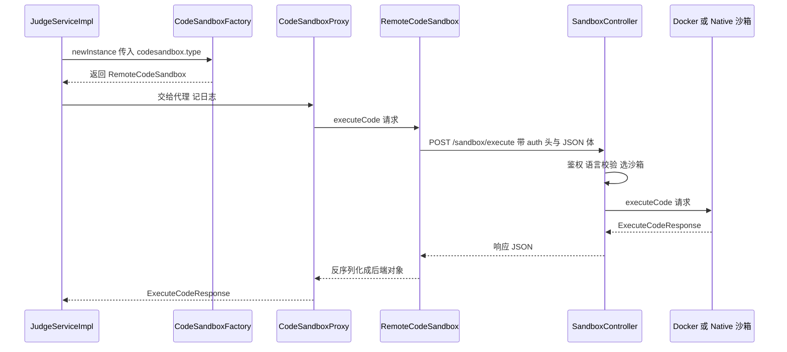
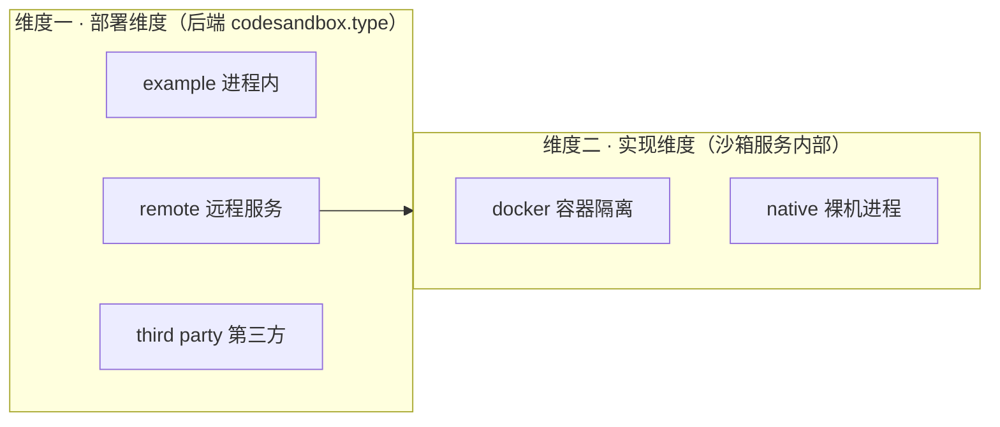

# 代码沙箱两端联调设计笔记

> 涉及两个项目：判题服务 `haxoj-backend`（调用方）与代码沙箱 `haxoj-code-sandbox`（执行方）。
> 本笔记记录两端的通信契约、鉴权方案，以及 `remote` / `native` / `docker` 这几个概念的分界与取舍。

---

## 一、总览：一句话说清两端在干什么

后端判题服务**不自己执行用户代码**，它把「要跑什么代码」打包成一次 HTTP 请求，发给独立部署的代码沙箱服务；沙箱执行完，把结果按同样的结构打回来。

```
haxoj-backend  ──── HTTP POST /sandbox/execute ────▶  haxoj-code-sandbox
   :8101                                                    :8080
  调用方 / 判题逻辑                                        执行方 / 隔离运行
```

| 项目 | 角色 | 端口 | 职责 |
|---|---|---|---|
| `haxoj-backend` | 调用方 | 8101（`context-path: /api`） | 业务逻辑、判题策略、把提交转成沙箱请求 |
| `haxoj-code-sandbox` | 执行方 | 8080 | 隔离运行用户代码、返回输出与耗时/内存 |

两边**不共享代码**，各自有一份同名的 `ExecuteCodeRequest` / `ExecuteCodeResponse` / `JudgeInfo`，靠 JSON 字段名对齐。

---

## 二、完整调用链路



后端这一侧的职责划分（对应 `judge/codesandbox` 包）：

- `CodeSandboxFactory`：根据配置字符串造出具体沙箱实现。
- `CodeSandboxProxy`：装饰器，只负责打请求/响应日志。
- `RemoteCodeSandbox`：真正发 HTTP 的那一层。

沙箱这一侧的骨架（`JavaCodeSandboxTemplate`）把流程写死成五步，子类只填第 3 步：

```
executeCode()
  ├── 1 保存代码到 tmpCode/<uuid>/Main.java
  ├── 2 javac 编译        ← 编译不过直接返回，不起容器
  ├── 3 runFile()         ← 唯一由子类决定的一步
  ├── 4 收集整理输出
  └── 5 删除临时目录       ← finally 里兜底
```

---

## 三、数据契约：两端靠字段名对齐

### 请求 `ExecuteCodeRequest`（后端 → 沙箱）

| 字段 | 类型 | 含义 |
|---|---|---|
| `code` | String | 用户提交的源码 |
| `language` | String | 语言，目前只支持 `java` |
| `inputList` | List\<String\> | 每个元素是一个测试用例的标准输入，如 `"1 2"` |

### 响应 `ExecuteCodeResponse`（沙箱 → 后端）

| 字段 | 类型 | 含义 |
|---|---|---|
| `outputList` | List\<String\> | 每个用例的标准输出 |
| `message` | String | 出错时的信息 |
| `status` | Integer | 见下表 |
| `judgeInfo` | JudgeInfo | 耗时、内存 |

`status` 的约定（前后端都按这个认）：

| 值 | 含义 | 谁的问题 |
|---|---|---|
| 1 | 正常跑完，`outputList` 里是答案 | — |
| 2 | 沙箱自身出错（编译环境炸了、拉不到镜像等） | 平台 |
| 3 | 用户代码本身有问题（运行报错、超时） | 答题人 |

### `JudgeInfo`

| 字段 | 类型 | 含义 |
|---|---|---|
| `message` | String | 判题结论，由**后端策略**填，沙箱侧留空 |
| `memory` | Long | 峰值内存（KB） |
| `time` | Long | 耗时（ms） |

> 注意：沙箱返回时 `judgeInfo.message` 是 `null`，最终结论由后端 `JavaLanguageJudgeStrategy` 比对 `judgeCaseList` 后写入。所以字段为空不会报错——这也是两端能解耦的前提。

### 契约维护的代价

两边是**两份独立的类**，只有字段名一致。任何一边改字段名/类型，另一边都会静默地解析成 `null`。改动时务必两边同步。

---

## 四、鉴权设计

两端各有一份相同的常量：

```java
private static final String AUTH_REQUEST_HEADER = "auth";
private static final String AUTH_REQUEST_SECRET = "secretKey";
```

**传输的不是明文密钥，而是它的 MD5 摘要**：

```
后端：header["auth"] = MD5("secretKey")
沙箱：MD5("secretKey").equals(header["auth"]) ? 放行 : 抛 403
```

这样做的意义与边界：

- **防住了**：密钥原文不出现在网络里，抓包拿不到 `secretKey`。
- **没防住**：这是单向摘要，不是真正的加密。抓包的人拿到摘要后**可以原样重放**，因为它每次请求都一样。
- **要更严谨**：用带时间戳/随机数的 HMAC 签名（摘要里混入请求时间和 nonce，服务端校验时效），才能防重放。当前是「简单鉴权」，够用即可。

鉴权失败返回 `403`（`ResponseStatusException(FORBIDDEN)`），后端的 `RemoteCodeSandbox` 先判 `httpResponse.isOk()`，非 2xx 直接抛 `BusinessException`，不会把错误页当业务数据解析。

---

## 五、概念辨析：`remote` / `native` / `docker` 是三个词，两个维度

这是整份笔记最值得记住的部分。

### 两个维度

- **维度一 · 部署维度**：代码在**哪台机器**上跑？
  - `example`：后端进程内跑（占位，不真跑）
  - `remote`：交给远程的沙箱服务跑
  - `third party`：交给第三方沙箱跑
- **维度二 · 实现维度**：在**那台机器**上，用什么方式隔离？
  - `docker`：容器隔离（内存/CPU/网络/文件系统四道锁）
  - `native`：裸机进程，**零隔离**



### 所以：`remote` 和 `native` 不是同一层的选项

| 词 | 出现在哪 | 回答的问题 |
|---|---|---|
| `example` / `remote` / `third party` | 后端 `codesandbox.type` | 用**哪个沙箱服务** |
| `docker` / `native` | 沙箱服务内部 | **那个服务里**怎么隔离 |

`native` 听起来像是和 `remote` 并列的选项，其实**它俩都是 remote**——都打 8080 那个项目。把它们并列，等于说「我要用远程服务，还是用远程服务」，逻辑上自相矛盾。

---

## 六、决策：分界点放在哪里

### 曾经的候选方案

| 方案 | 做法 | 问题 |
|---|---|---|
| A. 后端接口里拼 `?type=` | `RemoteCodeSandbox` 把 type 拼到 URL 上 | 方向对，但「谁来决定拼什么」没定 |
| B. 后端工厂区分 `remote` / `native` | 多一个 `codesandbox.type` 取值 | 把两个维度混进同一个字段；远程服务每加一种实现，后端工厂就膨胀一次 |
| **C. 沙箱服务端配置决定** | 后端不传 type，服务端自己配 | —— |

### 选定方案 C，理由有三

1. **维度不混**：后端 `type` 只管「选哪个服务」，服务内部怎么跑是服务自己的事。
2. **docker/native 是部署能力**：这台机器有没有 Docker、跑在哪，是部署时确定的，不是调用方每次请求要操心的。
3. **安全**：`native` 是**零隔离**的——直接在本机 `java -cp <tmpDir> Main <input>` 跑用户代码：没有内存上限、没有超时（`TIME_OUT` 定义了却没被使用）、没有 `SecurityManager`，连黑名单校验都没了。

> 第 3 点决定了它**不能**成为后端的配置项。否则一旦误配、被改，或有人从外部请求 `?type=native` 把判题降级，那台判题机就等于裸奔。把它钉死在服务端的部署配置里，生产路径就不可能被外部降级。

### 最终形态：三层优先级

```
请求参数 type  ──有──▶  以参数为准        （仅本地调试，可手动覆盖）
      │ 无
      ▼
sandbox.type 配置  ──▶  服务端部署决定     （生产固定 docker）
      │ 缺失
      ▼
代码兜底默认 docker
```

对应实现：

```java
// 沙箱服务端
@Value("${sandbox.type:docker}")
private String sandboxType;

String actualType = StrUtil.isBlank(type) ? sandboxType : type;
CodeSandbox codeSandbox = "native".equalsIgnoreCase(actualType)
        ? new JavaNativeCodeSandbox1()
        : new JavaDockerCodeSandbox();
```

---

## 七、行为一览：什么情况走哪个沙箱

| 场景 | 是否传 type | 实际沙箱 | 决定权 |
|---|---|---|---|
| 后端判题（生产） | 不传 | 服务端配置（`docker`） | 服务端 |
| 后端判题 + 把 `sandbox.type` 改成 `native` | 不传 | `native` | 服务端 |
| 本地调试 `POST ?type=native` | 传 | `native` | 请求方 |
| `GET /sandbox/docker` | — | `docker` | 显式 |
| `GET /sandbox/native` | — | `native` | 显式 |

---

## 八、怎么测

### 只测沙箱服务（浏览器，最省事）

```
GET http://localhost:8080/sandbox/docker
GET http://localhost:8080/sandbox/native

# 换成别的测试代码，两个接口参数完全一样
GET http://localhost:8080/sandbox/docker?testCode=unsafeCode/SleepError.java
GET http://localhost:8080/sandbox/native?testCode=unsafeCode/SleepError.java
```

两个 GET 共用同一段 `runTestCode(...)`，只换沙箱实例——适合拿同一段代码**对照**两种沙箱的差异（比如 `SleepError` 在 docker 下被 5s 超时打断，在 native 下会一直睡）。

### 测正式接口（带鉴权）

```powershell
# 1. 算 MD5("secretKey")，结果是 32 位小写十六进制（和 hutool 的 SecureUtil.md5 一致）
$bytes = [Text.Encoding]::UTF8.GetBytes("secretKey")
$auth  = ([Security.Cryptography.MD5]::Create().ComputeHash($bytes) |
          ForEach-Object { $_.ToString("x2") }) -join ""

# 2. 发请求
$body = '{"code":"public class Main{public static void main(String[] a){System.out.println(Integer.parseInt(a[0])+Integer.parseInt(a[1]));}}","language":"java","inputList":["1 2"]}'

Invoke-RestMethod -Method Post `
  -Uri "http://localhost:8080/sandbox/execute?type=native" `
  -Headers @{ auth = $auth } `
  -ContentType "application/json" `
  -Body $body
```

> MD5 取的是**小写十六进制**，两端算法必须一致；改密钥时两边同时改。

### 端到端（走后端判题）

1. 后端起沙箱服务；
2. 把后端 `application.yml` 的 `codesandbox.type` 从 `example` 改成 `remote`；
3. 提交一次代码，观察后端日志里的「代码沙箱请求信息 / 响应信息」。

想整条链路走本地沙箱，无需动后端——把**沙箱服务**的 `sandbox.type` 改成 `native` 重启即可。这正是「开关放服务端」的好处。

---

## 九、踩坑与注意

| 项 | 说明 |
|---|---|
| 沙箱端口 | 实际是 **8080**。[application.yml](haxoj-code-sandbox/src/main/resources/application.yml) 里那个 `server.port: 12224335` 是越界的无效值，被同目录 `application.properties` 的 `server.port=8080` 盖住了才没出事——建议清理 |
| 两个 native 沙箱 | [JavaNativeCodeSandbox](haxoj-code-sandbox/src/main/java/com/hax/haxojcodesandbox/JavaNativeCodeSandbox.java) 里运行命令写坏了（`-cp %s;%s ... Main\n`，把输入当成了 classpath），实际不可用；用的是继承模板的 [JavaNativeCodeSandbox1](haxoj-code-sandbox/src/main/java/com/hax/haxojcodesandbox/JavaNativeCodeSandbox1.java) |
| 虚拟机部署 | 沙箱跑在别的机器时，改 `RemoteCodeSandbox` 里的 `SANDBOX_EXECUTE_URL`，把 `localhost` 换成那台机器 IP |
| 语言 | 目前只实现 Java；沙箱收到非 `java` 直接返回 `status=2`，不会误起容器 |
| 字段名 | 两端是两份独立类，改名 = 静默解析成 null，务必同步改 |
| 鉴权头 | 两端常量必须一致：头名 `auth`、密钥 `secretKey` |
| 输出末尾换行 | `System.out.println` 让输出变成 `"3\n"`，与题目里配的 `"3"` 逐字符比较不相等，会把完全正确的代码判成答案错误。详见第十节 |

---

## 十、踩坑复盘：输出末尾的 `\n`，让每一道题都判「答案错误」

这是两端联调跑通后撞上的第一个"看不见"的 bug，值得单独记一笔。

### 现象

提交「两数相加」，输入 `1 2`，预期输出 `3`，结果判成 **WRONG_ANSWER**。
在 `JavaLanguageJudgeStrategy#doJudge` 里打断点，两个字符串"看起来一模一样"：

| 来源 | 值 | 肉眼看到 |
|---|---|---|
| `judgeCase.getOutput()` | `"3"` | 3 |
| `outputList.get(0)` | `"3\n"` | 3 |

把值放进括号里，差别才露出来：

```
judgeCase.getOutput() = [3]      长度 1
outputList.get(0)     = [3\n]    长度 2   ← 多出来的那个字符是换行
```

### 这个换行是怎么一路走过来的

```
你写的 System.out.println(a + b)
  │   println = print + 换行 → 写进 stdout 的是 "3\n"，不是 "3"
  ▼
沙箱执行时的 onNext 回调（JavaDockerCodeSandbox）
  │   message.append(text)     原样追加原始字节，换行也在里面
  ▼
collectOutput（JavaCodeSandboxTemplate）
  │   outputList.add(...)      原样收进结果，全程没有任何一步处理它
  ▼
后端 JavaLanguageJudgeStrategy
  │   "3".equals("3\n")  →  false
  ▼
WRONG_ANSWER
```

> 佐证：在整份沙箱代码里搜 `replace` / `trim` / `\n`，**一处都搜不到**。
> 这说明换行不是"某处处理错了"，而是**从头到尾没人处理过**。

### 根因：两端对"输出"的定义不一样

| | 它认为的"输出"是什么 |
|---|---|
| 沙箱 | 进程 **stdout 的原始字节** —— 程序写什么就是什么，包含 `println` 的那个换行 |
| 题目里的 `judgeCase.output` | **人眼看到的答案** —— 出题人手敲的 `3` |

再叠上两个事实：

1. `println` 是 `print` + 换行，这是 JVM 的行为，不是谁的 bug；
2. `String.equals` 是**逐字符**比较，空白也是字符 —— `"3"` 和 `"3\n"` 是两个不同的字符串。

三条凑在一起，就成了"看起来一样，判起来不等"。

### 为什么它难排查

两端各自单独看都是"对"的：沙箱日志打出来的确是个 `3`，题目里配的的确也是个 `3`。
因为**肉眼看到的是"渲染后的文本"，而比较发生在"字符数组"上** —— 换行在终端里表现为"光标换到下一行"，看上去就跟没有一样。

所以排查这类问题要换手法：

```java
System.out.println("[" + s + "]");   // 用括号框住，换行无处可藏
System.out.println(s.length());      // 或者直接看长度，更省事
```

### 修复

放在**沙箱模板**的 `collectOutput` 里，一行：

```java
String output = executeMessage.getMessage();
outputList.add(output == null ? null : StrUtil.trimEnd(output));
```

三个取舍：

- **用 `trimEnd` 而不是 `trim`**：只去末尾。如果题目答案是多行的（期望 `"1\n2"`），行内的换行属于答案本身，必须保留。而且 `trimEnd` 连 `\r` 一起收 —— 沙箱在 Linux 容器里 `println` 出的是 `\n`，如果 native 沙箱跑在 Windows 上，出的是 `\r\n`，两种都能处理。
- **放在模板里，而不是某个具体沙箱里**：模板是所有沙箱唯一的公共代码，docker / native / 以后接的第三方沙箱自动都生效。
- **不放在后端判题策略里**：判断"多一个换行算不算答案正确"属于"沙箱应该返回什么样的输出"的问题，应该由沙箱把输出**整理干净**再交给后端；后端的 `equals` 保持严格比较是对的。

> 改完还要**重新部署沙箱服务**（本机 → Git → 虚拟机 pull → `mvn package` → 重启 jar），否则跑的还是老代码。

### 教训

- 跨进程 / 跨服务传字符串时，**"看起来一样" ≠ "相等"**。换行、`\r\n`（Windows 与 Linux 的差异）、编码，都能让两个"看起来一样"的字符串不相等。
- **`println` 自带换行**，输出里必然多一个字符；想让程序输出"干净"，就该用 `print`。
- **契约要写清"含不含末尾换行"**。这次本质上不是代码写错了，而是两端对同一个字段的约定不一致 —— 靠默契的地方，迟早要还。

---

## 十一、文件索引

### 后端 `haxoj-backend`

| 文件 | 作用 |
|---|---|
| `judge/JudgeServiceImpl.java` | 判题主流程，组装请求、调用沙箱、回写状态 |
| `judge/codesandbox/CodeSandboxFactory.java` | 按 `codesandbox.type` 造沙箱 |
| `judge/codesandbox/CodeSandboxProxy.java` | 日志装饰器 |
| `judge/codesandbox/impl/RemoteCodeSandbox.java` | **HTTP 调用方**，带鉴权头 |
| `judge/codesandbox/model/*.java` | 请求/响应/JudgeInfo 契约 |

### 沙箱 `haxoj-code-sandbox`

| 文件 | 作用 |
|---|---|
| `controller/SandboxController.java` | **HTTP 入口**：POST `/execute`、GET `/docker`、`/native`；鉴权、语言校验、选沙箱 |
| `JavaCodeSandboxTemplate.java` | 五步模板骨架 |
| `JavaDockerCodeSandbox.java` | 容器隔离实现 |
| `JavaNativeCodeSandbox1.java` | 裸机实现（无隔离，仅调试） |
| `model/*.java` | 与后端同构的契约类 |
| `resources/application.yml` | `sandbox.type` 部署开关 |